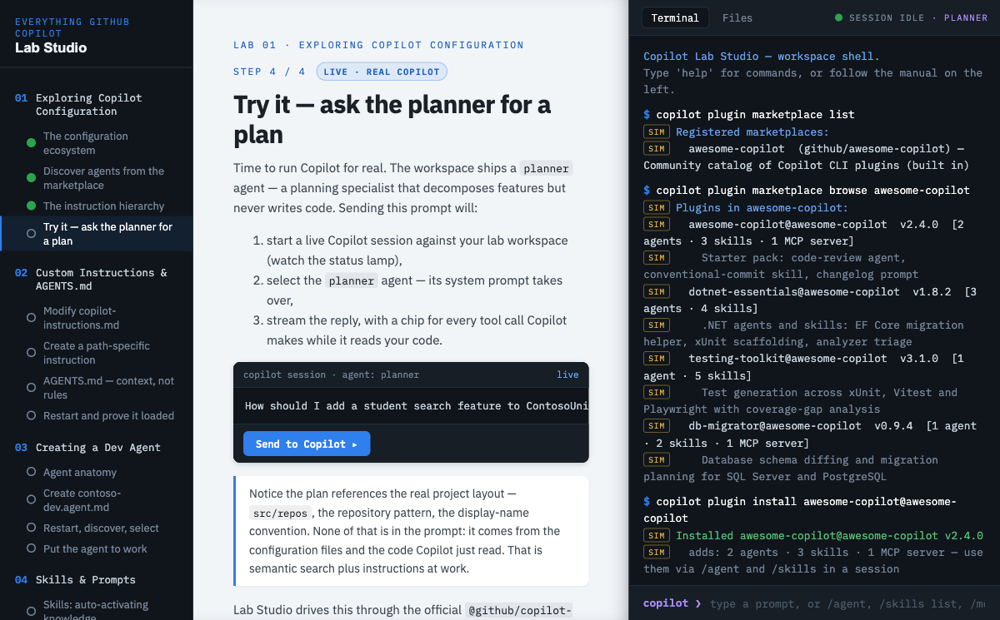

# Copilot Lab Studio

Run **all 20 labs** of the _Everything GitHub Copilot_ workshop entirely in the
browser — a guided SPA with a **live GitHub Copilot session** on the right-hand
"bench", driven through the official [`@github/copilot-sdk`](https://www.npmjs.com/package/@github/copilot-sdk).



| Pane                | What it is                                                                                                                                            |
| ------------------- | ----------------------------------------------------------------------------------------------------------------------------------------------------- |
| **Rail** (left)     | Labs 01–20 with per-step punch-holes that fill green as steps verify                                                                                  |
| **Manual** (center) | The teaching content — prose, concept tables, and action cards                                                                                        |
| **Bench** (right)   | A terminal that emulates the Copilot CLI against a sandboxed workspace, a Files editor, and the simulated GitHub tab (issues, PRs, Actions, settings) |

Everything **blue is real**: prompts, custom agents, skills (including
auto-activation via the `skill.invoked` event), instruction discovery, and MCP
tool calls round-trip through an actual Copilot session. Everything **amber is
simulated** — the plugin marketplace and anything that would need a GitHub
remote — so the labs work without a fork, a remote, or marketplace access.
Every step ends with a **Verify** check that inspects the real workspace state
server-side.

## Prerequisites

| Requirement                                     | Why                                                   | Check            |
| ----------------------------------------------- | ----------------------------------------------------- | ---------------- |
| **Node.js 22+**                                 | runs the server and the bundled Copilot SDK runtime   | `node --version` |
| **git**                                         | the sandbox workspace is its own git repository       | `git --version`  |
| **Copilot auth** (one of the two options below) | the live sessions bill against a real Copilot license | —                |

**Copilot auth, pick one:**

1. **Interactive machine (simplest):** sign in once with the Copilot CLI —
   `npm i -g @github/copilot && copilot login`. The studio reuses that login
   through the SDK forever after; it never asks for credentials itself.
2. **Headless server / container:** set `COPILOT_GITHUB_TOKEN` (or `GH_TOKEN`)
   to a [fine-grained PAT](https://github.com/settings/personal-access-tokens/new)
   with the **Copilot Requests** permission. No CLI install needed — the SDK
   ships its own runtime.

> Auth is only exercised when the first session starts (type `copilot` in the
> bench terminal, or run any blue "live" card). The app itself boots without it.

## Build & launch

There is no database and no external service — the whole deployment is: install
dependencies, build the static client, run one Node process. State lives in
`.sandbox/` (disposable) and the browser's localStorage (progress).

### On your computer

```bash
git clone <this repo> && cd day-in-the-life-copilot-lab/lab-studio
npm install --include=dev   # --include=dev matters only if your npm config sets omit=dev
npm start                   # builds the client, serves app + API at http://localhost:5180
```

Open **http://localhost:5180** — that's it. First build takes ~1 minute
(mostly `npm install`); after that, `npm start` is a few seconds of Vite build
plus server boot.

For development with hot reload:

```bash
npm run dev                 # server on :5180, Vite client with HMR on :5190
```

Other commands: `npm test` (server unit tests) · `npm run typecheck`.

### On a server

Same two commands, plus auth and (optionally) a network bind:

```bash
cd lab-studio && npm install --include=dev
COPILOT_GITHUB_TOKEN=<fine-grained PAT> \
LAB_STUDIO_HOST=0.0.0.0 \
LAB_STUDIO_PORT=5180 \
npm start
```

Run it under your process manager of choice (systemd, pm2, a tmux pane) — it's
one long-lived process. Two things to know before exposing it:

- **One instance = one learner.** There is a single sandbox workspace and a
  single Copilot session per server. For a workshop, run one instance per
  attendee (distinct ports or containers), not one shared URL.
- **It binds loopback by default on purpose.** The studio has no
  authentication, and its terminal drives a live Copilot session with tool
  access on the host. Setting `LAB_STUDIO_HOST=0.0.0.0` prints a warning —
  only do it on a trusted network or behind an authenticating reverse
  proxy/VPN.

### In a container

A `Dockerfile` ships in this directory (one container = one learner):

```bash
cd lab-studio
docker build -t lab-studio .

# auth via token:
docker run --rm -p 5180:5180 -e COPILOT_GITHUB_TOKEN=<PAT> lab-studio

# or reuse an existing `copilot login` from the host:
docker run --rm -p 5180:5180 -v ~/.copilot:/root/.copilot lab-studio
```

The image installs git + bash (the sandbox and hook scripts need them), builds
the client, and starts the server bound to `0.0.0.0` inside the container —
publish the port only where you'd accept the network-bind caveat above. The
build steps mirror the npm path verified on macOS; the image itself hasn't
been through CI yet, so treat the first build on your engine as a smoke test.

### Environment variables

| Variable                            | Default     | Effect                                                                        |
| ----------------------------------- | ----------- | ----------------------------------------------------------------------------- |
| `LAB_STUDIO_PORT`                   | `5180`      | HTTP port for app + API                                                       |
| `LAB_STUDIO_HOST`                   | `127.0.0.1` | Bind address; set `0.0.0.0` to serve the network (see warning above)          |
| `LAB_STUDIO_ORIGINS`                | —           | Comma-separated extra browser origins (e.g. `http://lab-host:5180`). Loopback origins on the API and Vite ports are always allowed; `/api` mutations from any other origin, and any other `Host`, get 403 |
| `LAB_STUDIO_SANDBOX`                | `.sandbox`  | Directory holding the learner workspace; `npm test` points it at a temp dir   |
| `COPILOT_GITHUB_TOKEN` / `GH_TOKEN` | —           | Fine-grained PAT with **Copilot Requests**; overrides the logged-in-user auth |

### Keeping content in sync with labs/\*.md

Studio lab content is an **adaptation** of the workshop's `labs/*.md`, not a
build artifact — each markdown lab has a hand-authored counterpart in
`client/src/labs/labNN.tsx`, coupled to verify checks (`server/src/verify.ts`)
and the sandbox template. Nothing regenerates automatically; instead the sync
is detected deterministically and repaired agentically:

```bash
npm run drift            # exit 1 + report when any labs/*.md changed since last sync
npm run drift:accept     # record the current sources as in-sync (after updating the studio)
```

When drift is reported, the repo ships maintainer tooling for the repair —
run it from the **repository root** with the real Copilot CLI:

```bash
copilot --agent lab-studio-maintainer \
  -p "Sync Lab Studio with the lab markdown changes" --allow-all-tools
```

The `lab-studio-maintainer` agent (`.github/agents/`) follows the
`lab-studio-sync` skill (`.github/skills/`), which encodes the file mapping,
the sandbox adaptation rules (dotnet → Node mini-workspace translations), the
live-vs-simulated boundary, step/verify conventions, and the prove-it steps
(typecheck + tests) before `drift:accept`.

### Updating / resetting

- Pull new code → `npm install --include=dev && npm start` again (the client
  rebuild is part of `npm start`).
- The **reset workspace** button in the app's rail restores the sandbox to its
  template state; deleting `.sandbox/` by hand does the same on next boot.
- Existing sandboxes pick up newly shipped template files automatically on
  server start, without touching learner-edited files.

## How it works

```
Browser SPA (React + Vite)
   │  REST + Server-Sent Events
   ▼
Fastify server (lab-studio/server)
   ├─ sandbox.ts         copies server/template → .sandbox/workspace per run
   ├─ sim-terminal.ts    shell builtins + simulated `copilot plugin …` commands
   ├─ copilot-bridge.ts  one CopilotClient; sessions created per `copilot` /
   │                     `/new`, with the sandbox as workingDirectory
   └─ verify.ts          per-step checks against workspace + session state
   │
   ▼
@github/copilot-sdk  →  Copilot CLI runtime (JSON-RPC)
```

The learner's workspace is a disposable copy of `server/template/` — a
miniature TypeScript ContosoUniversity with the same `.github/` + `.copilot/`
configuration surfaces the real workshop repository uses. **Reset workspace**
in the rail restores it.

### SDK notes (hard-won, verified by probing)

The Copilot SDK harness is _not_ identical to the interactive CLI:

- `.github/copilot-instructions.md` and `AGENTS.md` **are** discovered from the
  session's `workingDirectory` automatically.
- `.github/agents/` and `.github/skills/` are **not** — an SDK host must pass
  `agentDirectories` / `skillDirectories` in the session config (full
  `enableConfigDiscovery` requires an extension SDK path). The bridge does this
  on every session start.
- `session.rpc.agent.list` skips the project scan unless you pass
  `agentDirectories` to the call itself.
- Discovery events (`session.skills_loaded`, `session.mcp_servers_loaded`)
  arrive lazily — often on the first turn — so `/skills`, `/mcp` and `/agent`
  answer from direct RPC pulls (`rpc.skills.list`, `rpc.mcp.list`).
- MCP servers from the sandbox's `.copilot/mcp-config.json` are passed per
  session; relative script paths are resolved against the sandbox so the
  shipped `lab-docs` stdio server (`template/.copilot/mcp/lab-docs.mjs`) works
  from any cwd.

### Session semantics the labs rely on

Configuration loads **once at session start** — exactly like the real CLI.
The studio keeps that behavior on purpose: labs 02–05 teach the
edit → restart (`/exit` + `copilot`, or `/new`) → verify loop, and the
`/instructions` command flags files created after the running session started.

## Lab map

| Lab                                 | Steps                                                                                                      | Live / simulated                                                     |
| ----------------------------------- | ---------------------------------------------------------------------------------------------------------- | -------------------------------------------------------------------- |
| 01 Exploring Copilot Configuration  | config map · marketplace · hierarchy · ask the planner                                                     | marketplace simulated, planner live                                  |
| 02 Custom Instructions & AGENTS.md  | repo rules · path rule · ADR · restart + `/instructions`                                                   | all live                                                             |
| 03 Creating a Dev Agent             | anatomy · create `contoso-dev` · discover + select · analyze                                               | all live                                                             |
| 04 Skills & Prompts                 | anatomy · create `contoso-testing` · auto-activation · prompts-vs-skills                                   | activation live (`skill.invoked`), prompt files explained (IDE-only) |
| 05 MCP Server Configuration         | inspect config · add `lab-docs` stdio server · live MCP tool call · markdown lessons                       | all live                                                             |
| 06 Hooks                            | config + load order · stdin IPC contract · create + pipe-test a hook · live firing (incl. a pre-hook deny) | hook scripts execute for real; firing is live                        |
| 07 Multi-Agent Orchestration        | design · workers (`contoso-qa`) · orchestrator · delegation run                                            | live — real `task` dispatches with subagent chips                    |
| 08 gh-aw: PRD Generation            | md+frontmatter format · compile to .lock.yml · issue backlog · branch-triggered run · PRD review           | GitHub plumbing simulated; the PRD agent is a live Copilot session   |
| 09 Coding Agent & Code Review       | ruleset · issue → draft PR · automated review · @copilot iteration                                         | platform simulated; coding agent + reviewer are live sessions        |
| 10 Agent Memory                     | layer 1 (todos) · wiki + recall · schema rule firing · consolidation                                       | all live                                                             |
| 11 Building & Distributing a Plugin | scaffold + local install · registries/release pipeline · allowlist policy                                  | local install + policy evaluation real; registry simulated           |
| 12 Fabric MCP (offline path)        | why Fabric MCP · wire `fabric-sim` · enumerate + query the lakehouse                                       | real MCP wiring, fixture data (the lab's own offline path)           |
| 13 A2A Concepts                     | peers vs sub-agents · implementer/critic cycle · failure modes                                             | critic cycle live                                                    |
| 14 Orchestrator + tmux Pattern      | the cycle · handoff drill (write → clear → resume) · token discipline                                      | handoff drill live                                                   |
| 15 LSP & Code Intelligence          | what LSP gives · watch the text-search fallback · when it still falls back                                 | fallback observation live                                            |
| 16 Enterprise Managed Settings      | mechanism + key shapes · strictKnownMarketplaces · admin walkthrough                                       | shape verification server-side; quiz                                 |
| 17 GitHub Admin Controls            | AI Controls + default-on model policy · audit log scope                                                    | quizzes                                                              |
| 18 Spec-Driven Design & Stacked PRs | write a spec · spec→PRD check · 2-layer stack · review per layer                                           | spec + reviews live; stack simulated                                 |
| 19 Self-Improving Agents            | the bounded workflow · local drift-scan dry run · why the bounds matter                                    | drift scan live                                                      |
| 20 Enterprise Token Optimization    | the right usage source · prompt/knowledge governance                                                       | quizzes                                                              |

The **GitHub tab** on the bench is the simulated platform surface (issues,
pull requests, Actions runs, repo settings) that labs 08, 09 and 18 drive.
Everything that would need a remote — branch triggers, workflow jobs, PR
plumbing, rulesets — is simulated there, while every AI inside it (the PRD
agent, the coding agent, code review, iteration) is a real Copilot session
whose tool calls stream into the run logs and PR timelines.

## Safety

Copilot runs with auto-approved tools (the labs' `--allow-all-tools`
equivalent) against the sandbox workspace in `.sandbox/` — the same trust
posture the workshop's own non-interactive examples use. The sandbox directory
is gitignored and disposable. Two containment measures keep sessions inside
it: the permission handler rejects file writes that resolve outside the
workspace, and the workspace is initialized as its own git repository so
`git rev-parse --show-toplevel` (an agent favorite) resolves to the sandbox,
not the enclosing checkout.
