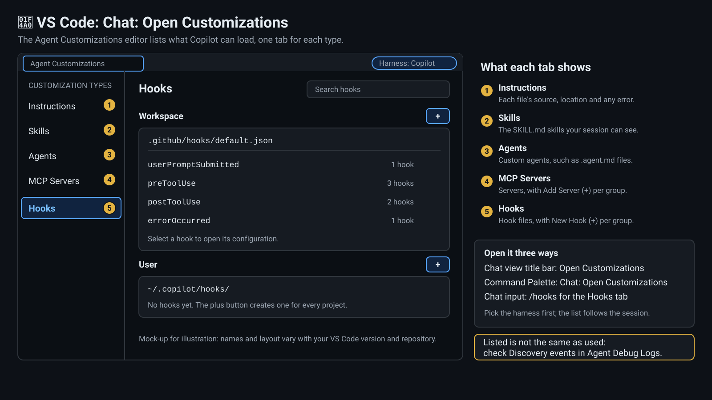

# 1 — Exploring Copilot Configuration

In this lab you will discover and understand the Copilot configuration files that ship with this repository.

> ⏱️ Presenter pace: 4 minutes | Self-paced: 10 minutes

**Prerequisite:** finish [Setup](setup.md) first — `copilot --version` prints a version number, and you are signed in to GitHub Copilot.

References:
- [Custom agents configuration](https://docs.github.com/en/copilot/reference/custom-agents-configuration)
- [Agent skills](https://docs.github.com/en/copilot/concepts/agents/about-agent-skills)
- [Custom instructions](https://docs.github.com/en/copilot/how-tos/copilot-on-github/customize-copilot/add-custom-instructions/add-repository-instructions)
- [Add skills to Copilot CLI](https://docs.github.com/en/copilot/how-tos/copilot-cli/customize-copilot/add-skills)

## The Three Surfaces Legend: where am I typing?

Every step in these labs happens on one of three surfaces. Each step names its surface with a badge, so a shell command never ends up in Copilot and a Copilot prompt never ends up in your shell. [Setup](setup.md) shows the same legend.

| Badge | Surface | What belongs here |
|-------|---------|-------------------|
| 🐚 **In your OS Terminal (Bash / PowerShell)** | Your normal shell prompt (`$` in Bash, `PS>` in PowerShell) | Commands run at your normal shell prompt: `dotnet`, `git`, `gh`, `copilot --version` |
| 🤖 **In Copilot CLI (`copilot>` session)** | An interactive session that you start by typing `copilot` in the OS Terminal | Slash commands (`/agent`, `/skills`, `/instructions`, `/env`, `/diagnose`) and natural-language prompts typed *inside* the session |
| 💠 **In VS Code (Editor & Copilot Chat)** | The VS Code editor and the Copilot Chat view | Creating and editing `.github/` files in the editor, the Agent Customizations UI (`Chat: Open Customizations` → Instructions, Skills, Agents, MCP Servers, Hooks), and `Show Agent Debug Logs` / `Show Chat Debug View` |


> 💡 **The badge names what you type into, not the window it sits in.** VS Code's integrated terminal is still a 🐚 OS Terminal. Run `copilot` there and you are in 🤖 until you type `/exit`. Typed inside a `copilot>` session, `cat` or `dotnet` goes to the model as chat text, not to your shell. Two other markers are not places you type: 🌐 is a page on GitHub.com in your browser (or a web/global-scope note), and 💬 is a discussion question to answer aloud.

## 1.1 The Configuration Ecosystem

This repository ships with a rich set of Copilot configurations. Here's the map — the rest of the labs fill it in:

| Directory | What | Count | Lab |
|-----------|------|-------|-----|
| `.github/agents/` | Specialized AI personas (`.agent.md`) | 4 (+ more in Lab 03) | Lab 03 |
| `.github/skills/` | Reusable command templates and auto-activating knowledge packs (`SKILL.md`) | 26 | Labs 04, 10, 14 |
| `.github/instructions/` | Path-specific rules (`.instructions.md`) | 4 | Lab 02 |
| `.github/copilot-instructions.md` | Repository-wide rules (always loaded) | 1 | Lab 02 |
| `AGENTS.md` | Non-obvious project context (always loaded) | 1 | Lab 02 |
| `.github/hooks/` | Lifecycle guardrails (`default.json`) | 4 lifecycle hook events (`preToolUse`, `postToolUse`, `userPromptSubmitted`, `errorOccurred`) | Lab 06 |
| `.copilot/mcp-config.json` | External tool integrations | 4 servers | Lab 05 |
| `.github/workflows/*.md` | Cloud-side AI automation (gh-aw) | 4 | Labs 08-09 |

🐚 **In your OS Terminal — quick look, pick any one:**

**WSL/Bash:**
```bash
# See the agents
ls .github/agents/

# Read one to see the anatomy (YAML frontmatter + markdown body)
cat .github/agents/planner.agent.md
```

**PowerShell:**
```powershell
# See the agents
Get-ChildItem .github/agents/

# Read one to see the anatomy (YAML frontmatter + markdown body)
Get-Content .github/agents/planner.agent.md
```

💠 **In VS Code:** open the same file from the Explorer (or press <kbd>Ctrl</kbd>+<kbd>P</kbd>, <kbd>Cmd</kbd>+<kbd>P</kbd> on macOS, and type `planner`). The text between the two `---` lines is the YAML frontmatter; everything below is the agent's instructions.

## 1.2 The Instruction Hierarchy

Copilot **combines** every instruction source that applies to what you are doing — it does not rank them or pick a winner. What matters is *what loads when*, and understanding that is the single most important concept:

| Scope | Source | When Loaded |
|----------|--------|-------------|
| Whole repository | `.github/copilot-instructions.md` | **Always** — every interaction |
| Whole repository | `AGENTS.md` | **Always** — every interaction |
| Files matching `applyTo` | `.github/instructions/*.instructions.md` | Only when the file's `applyTo` glob matches files in context |
| Matching topics | `.github/skills/*/SKILL.md` | When description matches the conversation topic |
| The selected agent | Agent profile (`.agent.md`) | When you select the agent with `/agent` (or start with `copilot --agent NAME`) |
| The command you run | Command skill (`SKILL.md` with `disable-model-invocation: true`) | Only when you type `/skill-name` — never from topic matching (see Lab 04) |

In a 🤖 Copilot CLI session, type `/instructions` to see which instruction files Copilot found and to turn them on or off.

> 💡 **Key insight:** Instructions cascade and stack. If `copilot-instructions.md` says "use immutable patterns" and `dotnet.instructions.md` says "use async/await", **both** apply when editing `.cs` files. Copilot does not resolve conflicts between them, so avoid writing instructions that contradict each other.

## 1.3 How Copilot Finds Your Code

Copilot doesn't just do keyword text search — it uses multiple layers of code intelligence:

| Layer | How It Works | Scope |
|-------|-------------|-------|
| **Semantic indexing** | Builds a meaning-based index of your codebase. Understands intent, not just keywords. | Local repo |
| **LSP integration** | When a language server is configured (a project `.github/lsp.json` that you add — this repo doesn't ship one — or a personal `~/.copilot/lsp-config.json`), Copilot CLI automatically prefers it over text search for go-to-definition, find references, hover, rename, workspace symbol search, go-to-implementation, and call hierarchy — no slash command needed. See [Lab 15 — LSP & Code Intelligence](lab15.md). | Local repo |
| **ripgrep + glob** | Fast pattern-based search for exact matches across files — the fallback when no LSP server is configured for a language | Local repo |
| **GitHub MCP** | Semantic code search across **any GitHub repo** you have access to — remotely. The agent can scan codebases it's never seen locally. | Remote (GitHub) |

> 💡 When you ask Copilot "how does authentication work in this project?", it's using semantic search — not `grep`. It understands meaning. And with the GitHub MCP server, it can do the same across remote repos. For precise symbol-level navigation (go-to-definition, rename, call hierarchy), Copilot reaches for a configured LSP server before falling back to text search.

## 1.4 Try It

🐚 **In your OS Terminal:**

```bash
# Interactive: start Copilot CLI, then select the planner agent
copilot
```

🤖 **In Copilot CLI (`copilot>`):** select the planner with `/agent planner` (or type `/agent` on its own and pick it from the list), then ask:

```text
How should I add a student search feature to ContosoUniversity?
```

> 💡 In the CLI, `@` mentions a *file* (for example `@AGENTS.md`) — it does not select an agent. Pick an agent with `/agent` in a session, or with `--agent` when you start `copilot`.

🐚 **In your OS Terminal — non-interactive equivalent** (handy for CI, smoke checks, or shared
workstations where you'd rather not leave a TTY session open):

```bash
copilot --agent planner \
  --prompt "How should I add a student search feature to ContosoUniversity?" \
  --allow-all-tools
```

```powershell
copilot --agent planner `
  --prompt "How should I add a student search feature to ContosoUniversity?" `
  --allow-all-tools
```

> 💡 Notice how Copilot references the project's architecture, file structure, and conventions — all loaded from the configuration files we just explored. This is semantic search in action.

> 💡 Copilot loads agents from `.github/agents/` in the current working directory. You can also place personal agents in `~/.copilot/agents/`.

💠 **In VS Code (Editor & Copilot Chat):** run the same exercise without the terminal.

1. Open the Copilot Chat view with the **Copilot** harness selected, choose `planner` from the **Agent** dropdown, and send the same question. Custom agents from `.github/agents/` appear in that dropdown.
2. Open the Command Palette (<kbd>Ctrl</kbd>+<kbd>Shift</kbd>+<kbd>P</kbd>, or <kbd>Cmd</kbd>+<kbd>Shift</kbd>+<kbd>P</kbd> on macOS) and run **Chat: Open Customizations**. Its tabs (**Instructions**, **Skills**, **Agents**, **MCP Servers** and **Hooks**) list what Copilot can load from this repository. A listed file was *discovered*; that is not proof it was used, and the callout below shows how to check.



> **🔍 Debug It (VS Code & Copilot CLI)** — *Did Copilot really load those files?*
>
> A good answer does not prove the configuration loaded: Copilot may simply have guessed well. Check what it found instead of asking it to describe itself.
>
> - **Copilot CLI:** type these inside a running `copilot` session, not at your shell prompt. `/instructions` lists the instruction files Copilot found and lets you switch each one on or off, and `/env` shows everything the session loaded: instructions, MCP servers, skills, agents, hooks, plugins, LSPs and extensions.
> - **VS Code:** open the Chat view's **...** menu and choose **Show Agent Debug Logs**, then look at the **Discovery** events to see whether a file was loaded, skipped or rejected. **Show Chat Debug View** shows the **System prompt** that reached the model, where request details are available.
>
> If you use VS Code, turn capture on before you reproduce the problem, because it is not retroactive: [the guide shows how](../docs/debugging-and-observability.md#21-turn-capture-on-before-you-reproduce). The Copilot CLI checks need no setup.

This is how the Copilot CLI checks look inside a session. The capture is illustrative, and `/context` and `/diagnose` come back in later labs:


---

## 1.0a Copilot CLI currency (2026 refresh)

> 🧭 **The core concepts are done — what follows is optional extension.** §1.1–§1.4 covered what the configuration files are, how Copilot combines them, how it finds code, and an agent answering from them. §1.0a (the CLI's current commands) and §1.0 (marketplace plugins) keep their original numbers so existing links still work, but they now come *after* the concepts on purpose: learn what these files are before you install more of them. Plugins are not a prerequisite for any later lab, so you can jump to [§1.5](#15-takeaway) at any point.

> 💡 The Copilot CLI surface evolves quickly. Commands are current as of this
> refresh; versions, model tiers, and MCP pins live in
> [`docs/_meta/registry.yaml`](../docs/_meta/registry.yaml) so labs stay
> consistent.

| Capability | Command / surface | Use when |
|------------|-------------------|----------|
| **Install a plugin** | `/plugin install owner/repo` (or `copilot plugin install owner/repo`) | Pulling a marketplace or private-registry plugin. Covered in depth below and in Lab 11. |
| **Parallel subagents** | `/fleet` | Running independent research or implementation threads in one session. |
| **Plan mode vs autopilot mode** | `/plan` or `Shift+Tab` for plan mode (review each step) vs `/autopilot` to toggle autopilot mode (batch execute) | Plan mode for exploratory/risky work; autopilot mode for scripted, well-understood tasks. Autopilot is a toggle you switch on — it is not the default. |
| **Mid-session model switch** | `/model MODEL-ID` (or `/model auto` to let Copilot choose) | Pick an id from the registry's `models.cheap` for routine edits; pick one from `models.premium` for deep reasoning. |
| **Local tool discovery** | `extensions_manage` MCP tool — operation one of `list` \| `inspect` \| `scaffold` \| `guide` (model-side tool call, **not** a slash command) | Inspecting which extensions are loaded — the in-repo analogue of a marketplace. Ask Copilot e.g. *"run `extensions_manage` with operation `list`"*. |

*Lab 11 builds an enterprise plugin that publishes to a private
`COPILOT_PLUGIN_REGISTRIES` registry using exactly this surface.*

## 1.0 Discover Agents from the Marketplace

The Copilot CLI plugin marketplace is a registry of community and first-party agents you can install directly from your terminal. Plugins extend Copilot with specialized capabilities — think of them as pre-built agents for common development tasks.

### Browse available plugins

🐚 **In your OS Terminal:**

```bash
# List registered marketplaces
copilot plugin marketplace list

# Browse available plugins in a marketplace
copilot plugin marketplace browse awesome-copilot
```

Browse the available plugins and look for ones related to **.NET**, **testing**, or **database management** — these will be most useful for the ContosoUniversity project we'll work with throughout these labs.

### Install a plugin

You can install a plugin by name from a marketplace, or directly from a GitHub repository that contains a plugin:

🐚 **In your OS Terminal:**

```bash
# From a GitHub repo that contains a plugin (generic form)
copilot plugin install OWNER/REPO

# Worked example: the plugin named awesome-copilot, from the built-in awesome-copilot marketplace
copilot plugin install awesome-copilot@awesome-copilot

# Or install any other marketplace plugin by name
copilot plugin install PLUGIN-NAME@awesome-copilot
```

> 💡 **Marketplace, not plugin.** `github/awesome-copilot` is a *marketplace* — a catalog of plugins — so it is not something you install as a whole. The CLI includes that marketplace out of the box (that is why `browse awesome-copilot` works above), and a plugin also named `awesome-copilot` lives inside it. The `plugin@marketplace` form above installs exactly that plugin.

> ⏭️ **Skip this step if** you're on a restricted network, you don't have a
> GitHub auth token wired up yet, or this is a presenter-led run where the
> instructor has already installed plugins for the class. Plugin install is
> **not a prerequisite** for any later lab — Labs 02–10 work end-to-end without
> a single plugin installed. Lab 11 walks you through publishing your *own*
> plugin from scratch.

### Verify the installation

🐚 **In your OS Terminal:**

```bash
# Confirm the plugin is installed and ready
copilot plugin list
```

You should see your installed plugin listed with its name, version, and source.

### Use the plugin

Installing a plugin does not create a command named after the plugin. A plugin adds *components* — custom agents, skills, hooks, MCP servers and LSP servers — and you use each one by its own name:

- **Custom agents** — type `/agent` in a session to see the agents available to you and pick one, or start the session with `copilot --agent AGENT-NAME`.
- **Skills** — type `/skills` to see and manage them. Copilot uses a skill on its own when your request matches the skill's description.

🐚 **In your OS Terminal:**

```bash
# Interactive: start a session, then pick the plugin's agent with /agent
copilot
```

🤖 **In Copilot CLI (`copilot>`):** type `/agent`, choose an agent from the list, then type your request.

🐚 **In your OS Terminal — non-interactive** (CI, scripted or headless):

```bash
# Non-interactive (CI / scripted / headless): replace AGENT-NAME with a name from the /agent list
copilot --agent AGENT-NAME --prompt "help me with my task" --allow-all-tools
```

> 💡 **Key insight:** Marketplace plugins give you a head start for common workflows — but they're just the beginning. In Lab 03, you'll learn to **create your own agents** tailored to your team's specific needs. Think of marketplace plugins as patterns you can study and customize.

> ⚠️ **Offline or marketplace unavailable?** If you can't access the marketplace, skip to [§1.5](#15-takeaway). You have already covered the local configuration files in §1.1–§1.4, and the rest of the labs work entirely with them.

References:
- [Finding and installing plugins](https://docs.github.com/en/copilot/how-tos/copilot-cli/customize-copilot/plugins-finding-installing)
- [Creating custom agents](https://docs.github.com/en/copilot/how-tos/copilot-cli/customize-copilot/create-custom-agents-for-cli)

---

## 1.5 Takeaway

<details>
<summary>Key Takeaways</summary>

| Concept | File Location | Purpose |
|---------|--------------|---------|
| **Agents** | `.github/agents/*.agent.md` | Specialized AI personas with defined tools |
| **Skills** | `.github/skills/*/SKILL.md` | Auto-activating knowledge bases |
| **Instructions** | `.github/copilot-instructions.md` | Always-on repo-wide rules |
| **Path Instructions** | `.github/instructions/*.instructions.md` | Rules for specific file types |
| **AGENTS.md** | `AGENTS.md` (repo root) | Non-obvious project context (keep minimal) |
| **Command skills** | `.github/skills/*/SKILL.md` (`disable-model-invocation: true`) | Reusable commands, run as `/name` |
| **Hooks** | `.github/hooks/default.json` | Lifecycle guardrails |
| **MCP** | `.copilot/mcp-config.json` | External tool integrations |

</details>

**Next:** [Lab 02 — Custom Instructions & AGENTS.md](lab02.md)
