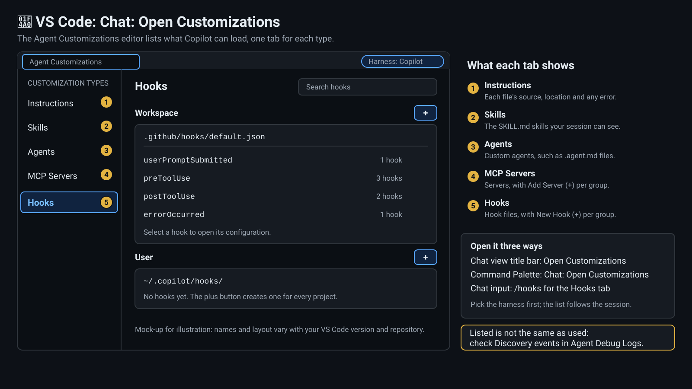

# 6 — Hooks

In this lab you will explore the hook system and create a new hook for .NET build verification. Three optional extras then widen the picture: a collapsible deep dive on all 15 hook lifecycle events (the end of §6.1), §6.2.2, which shows hooks written in other languages and hooks that call a web service, and §6.4.1, which shows how to see what Copilot did: debug logs, session data and OpenTelemetry.

> ⏱️ Presenter pace: 3 minutes | Self-paced: 10 minutes

> 📋 **Before you start.**
> - Finish [Lab 01](lab01.md) and [Setup](setup.md) first. §6.4 builds `dotnet/ContosoUniversity.sln`, so that solution must already build cleanly.
> - Open your 🐚 OS Terminal at the **repository root** (the folder that contains `scripts/` and `.github/`). Every path in this lab is relative to it.
> - Pick **one** shell and stay in it: the one your platform uses natively (PowerShell on Windows, Bash on macOS, Linux or WSL). **WSL/Bash** needs `jq`: the hook scripts use it to read the event and stop with an error if it is missing. **PowerShell** needs PowerShell 7 (the `pwsh` command, not Windows PowerShell 5.1), because §6.4 launches `pwsh`.

> ⏱️ **Timed route.** The timings above cover the core path in **one** shell: §6.1, the stdin-JSON idea (§6.2 and §6.2.1), §6.3, §6.4 (without its optional §6.4.1) and §6.6. Everything else is optional reference and is not timed: reading all three scripts in §6.2 steps 2–4 line by line (skim one), the other shell's blocks (such as the §6.3 script you are not using), the Copilot CLI currency table, the collapsible 15-event deep dive at the end of §6.1, all of §6.2.2 (hooks in other languages, shell-free `exec` and `"type": "http"` hooks) and all of §6.4.1 (debug logs, session data, `/diagnose` and OpenTelemetry).

References:
- [Using hooks with Copilot CLI](https://docs.github.com/en/copilot/how-tos/copilot-cli/customize-copilot/use-hooks)
- [Hooks reference: events, payloads and exit codes](https://docs.github.com/en/copilot/reference/hooks-reference)
- [Agent hooks in VS Code](https://code.visualstudio.com/docs/agent-customization/hooks) (the Copilot harness in VS Code shares the CLI's hook format)
- [Config reference §4: every hook type, event and output](../docs/copilot-config-reference.md#4-hooks)
- [Debugging and observability: VS Code debug views, CLI session data, `/diagnose` and OpenTelemetry](../docs/debugging-and-observability.md)

> 🧭 **Track appendices** — the post-tool-use build hook recipe per stack lives in
> [`labs/appendices/dotnet/lab06.md`](appendices/dotnet/lab06.md) and
> [`labs/appendices/node/lab06.md`](appendices/node/lab06.md).

## Copilot CLI currency (2026 refresh)

<!-- @include docs/_partials/currency.md — do not edit inline; edit the partial and re-sync. -->
> 💡 Commands below reflect the current Copilot CLI surface as of this lab
> refresh (CLI floor per [`docs/_meta/registry.yaml`](../docs/_meta/registry.yaml):
> see `copilot_cli_version_floor`). Versions, model tiers, and MCP server pins
> live in the registry — labs reference it rather than hardcoding values, so a
> single registry update propagates everywhere.

> 🆕 **Terminal UX refresh (GA June 23, 2026):** `/plugin`, `/mcp`, and
> `/skills` are real interactive commands backed by an in-terminal dashboard —
> you can discover, install, and configure plugins, MCP servers, and skills
> without hand-editing config files. The terminal also gained tabs for
> browsing issues/PRs/gists. Config-file editing still works and is what the
> underlying `extensions_manage` MCP tool inspects, but the dashboard is now
> the primary interactive path for a human at the prompt.

| Capability | Command / surface | Use when |
|------------|-------------------|----------|
| **Install a plugin** | `/plugin install owner/repo` (or the `/plugin` dashboard) | Pulling a packaged multi-agent or skill bundle from a marketplace or org-internal plugin source. |
| **Parallel subagents** | `/fleet` | Fanning work out across multiple short-lived workers under one orchestrator (see [Lab 14 — Orchestrator + tmux](../labs/lab14.md)). |
| **Plan mode vs autopilot mode** | `/plan` or `Shift+Tab` for plan mode vs `/autopilot` to toggle autopilot mode | Plan-heavy work (design, decomposition) runs in plan mode; well-scoped execution runs in autopilot mode. Autopilot is a toggle you switch on — it is not the default. |
| **Mid-session model switch** | `/model MODEL-ID` (or `/model auto` to let Copilot choose) | Upshift to `models.premium` (per [`registry.yaml`](../docs/_meta/registry.yaml)) for hard reasoning; downshift to `models.cheap` for tool-heavy loops. Note: an enterprise's global model-default-availability policy (see [Lab 17](../labs/lab17.md)) may make additional models selectable here even if the registry's curated tiers don't list them. The tier names are registry keys, not `/model` arguments. |
| **Local tool discovery (model-side)** | `extensions_manage` MCP tool, `operation: "list"` / `"inspect"` / `"guide"` / `"scaffold"` | The agent enumerating which agents, skills, hooks, and extensions are contributing to the session before wiring a handoff. Invoke as a tool call (e.g. `extensions_manage({operation: "list"})`), **not** as `/extensions_manage` — there is no such slash command. |
| **Local tool discovery (user-side)** | `/skills`, `/plugin`, `/mcp` | The human listing or managing skills, plugins, and MCP servers from the prompt via the in-terminal dashboard. These are real built-in slashes; `/extensions manage` and `/extensions mode` are **not** — use `Shift+Tab` to switch modes. |
| **LSP-backed code intelligence** | Automatic — no slash command | Copilot CLI transparently prefers a configured language server over text search for go-to-definition, find references, rename, and call hierarchy. See [Lab 15 — LSP & Code Intelligence](../labs/lab15.md). |
<!-- @end-include docs/_partials/currency.md -->

## 6.1 Examine the Hook Configuration

Hooks are scripts that run automatically at specific points in the Copilot lifecycle. They provide guardrails and automation.

🐚 **In your OS Terminal:**

1. View the hook configuration:

**WSL/Bash:**
```bash
cat .github/hooks/default.json
```

**PowerShell:**
```powershell
Get-Content .github/hooks/default.json
```

💠 **In VS Code:** or open the same hook files in the Agent Customizations editor. Run **Chat: Open Customizations** from the Command Palette and select **Hooks** (or type `/hooks` in the Chat view). Hook files appear under **Workspace** (this repository's `.github/hooks/`) and **User** (`~/.copilot/hooks/`), and the `+` button next to **Workspace** creates a new hook.



2. This repository's `default.json` registers seven hooks on the four lifecycle events below. The table is **non-exhaustive**: Copilot supports 15 lifecycle events in all (for example `sessionStart`, `sessionEnd` and `agentStop`). Open the collapsed **Deep Dive** at the end of this section for all 15, or read the [full event catalogue](../docs/copilot-config-reference.md#43-event-catalogue). GitHub's own list is the [hooks reference](https://docs.github.com/en/copilot/reference/hooks-reference#hook-events).

| Event | When It Fires |
|-------|--------------|
| `userPromptSubmitted` | After the user sends a message |
| `preToolUse` | Before Copilot executes a tool (edit, execute, etc.) |
| `postToolUse` | After Copilot executes a tool |
| `errorOccurred` | When an error happens |

3. Each hook entry has:
```json
{
  "type": "command",
  "bash": "./scripts/hooks/my-hook.sh",
  "powershell": "./scripts/hooks/my-hook.ps1",
  "timeoutSec": 10,
  "comment": "Description of what this hook does"
}
```

> 💡 Hooks run in both bash (Linux/Mac) and PowerShell (Windows). Provide both for cross-platform support, or write the hook once in a language that runs everywhere and launch it with a single entry (§6.2.2). `"type"` is `"command"` here; the other two types are `"http"` (send the event to a web service) and `"prompt"` (submit a prompt when a session starts), both in §6.2.2.

> 💡 **Where hooks load from:** `.github/hooks/*.json` is the project-level location this lab uses, but it is not the only one. Copilot CLI loads hooks from several sources, in this order: **policy hooks** (installed by an administrator and machine-wide; they load first and `disableAllHooks` cannot turn them off), **user hooks** in `~/.copilot/hooks/` (`%USERPROFILE%\.copilot\hooks\` on Windows), **project hooks** in `.github/hooks/*.json` (or an inline `hooks` block in `.github/copilot/settings.json`), then hooks contributed by **plugins**. They are combined: if the same event appears in more than one source, every entry from every source runs. Details: [hooks locations](https://docs.github.com/en/copilot/reference/hooks-reference#hooks-locations).

<details>
<summary>Deep Dive: All 15 Hook Lifecycle Interrupts & Surface Matrix</summary>

Copilot defines **15** hook lifecycle events. This deep dive calls them *interrupts*: each one is a point where Copilot hands control to your hook so it can look, decide or add context. Most run synchronously and make the agent wait; `notification` is fire-and-forget and never blocks. Fourteen are listed in the [GitHub hooks reference](https://docs.github.com/en/copilot/reference/hooks-reference#hook-events). The fifteenth, `preMcpToolCall`, is documented only in the Copilot CLI's built-in documentation (`/config` lists it under Capabilities > Hooks as `hooks.preMcpToolCall`); it is not in the GitHub hooks reference's event table. Copilot CLI fires all 15.

Write the event name in camelCase (`preToolUse`) to get a camelCase payload, or in PascalCase (`PreToolUse`) to get the VS Code and Claude compatible snake_case payload. Only 11 events document a PascalCase alias, shown in brackets below. `userPromptTransformed`, `preMcpToolCall`, `subagentStart` and `notification` have none, so always write those four in camelCase.

![A swimlane diagram of the 15 hook lifecycle events in four groups: Session (sessionStart, preCompact, notification, errorOccurred, sessionEnd), Turn and prompt (userPromptSubmitted, userPromptTransformed, agentStop), Subagent (subagentStart, subagentStop) and Tool execution (permissionRequest, preToolUse, preMcpToolCall, postToolUse, postToolUseFailure). Four events can block, and preMcpToolCall is drawn dashed because it comes from the CLI build docs. Two panels below compare a command hook, which reads the event on stdin, with an HTTP hook, which posts it to a web service.](../docs/images/labs/hooks-lifecycle-15-events.svg)

**Session interrupts**

| Event (PascalCase alias) | Fires when | A hook can | Cloud agent | VS Code |
|---|---|---|---|---|
| `sessionStart` (`SessionStart`) | A new or resumed session begins | Add context with `additionalContext`, or auto-submit a prompt with a `"type": "prompt"` hook | Once per job, as a new session | ✅ |
| `preCompact` (`PreCompact`) | Just before manual or automatic context compaction | Observe only: it cannot block compaction. A `matcher` can pick `manual` or `auto` | Only `auto` fires | ✅ |
| `notification` (no alias) | The CLI emits a system notification, such as a finished background shell, an idle agent or a permission prompt | Inject `additionalContext` as a user message. Fire-and-forget: it never blocks | Does not fire | — |
| `errorOccurred` (`ErrorOccurred`) | An error occurs. The reference lists four contexts (`model_call`, `tool_execution`, `system`, `user_input`); the CLI's own setting text says it runs when a model call fails | Log or notify only | Fires | — |
| `sessionEnd` (`SessionEnd`) | The session ends: `complete`, `error`, `abort`, `timeout` or `user_exit` | Clean up or log only | Once per job | ✅ |

**Turn and prompt interrupts**

| Event (PascalCase alias) | Fires when | A hook can | Cloud agent | VS Code |
|---|---|---|---|---|
| `userPromptSubmitted` (`UserPromptSubmit`) | The user submits a prompt | Observe or log. A command or HTTP hook's output is dropped here; `modifiedPrompt` is honored only by SDK hooks | At most once per job | ✅ |
| `userPromptTransformed` (no alias) | After Copilot turns the prompt into model-facing content, before it is saved to history | Rewrite what the model sees with `modifiedTransformedPrompt`. It cannot block the turn | Fires | — |
| `agentStop` (`Stop`) | The main agent finishes a turn | `{"decision": "block", "reason": "..."}` forces another turn | Fires | ✅ |

**Subagent interrupts**

| Event (PascalCase alias) | Fires when | A hook can | Cloud agent | VS Code |
|---|---|---|---|---|
| `subagentStart` (no alias) | A subagent is spawned (the built-in `general-purpose` agent is excluded) | Add `additionalContext` to its first message. It cannot block creation. A `matcher` can pick the agent name | Fires | ✅ |
| `subagentStop` (`SubagentStop`) | A subagent finishes, before the parent sees its result | `block` plus a `reason` to make it continue, or `modifiedResponse` to redact or reformat the result | Fires | ✅ |

**Tool-execution interrupts**

| Event (PascalCase alias) | Fires when | A hook can | Cloud agent | VS Code |
|---|---|---|---|---|
| `permissionRequest` (`PermissionRequest`) | Before Copilot's permission service runs | Allow or deny programmatically with `behavior`. A `matcher` can pick the tool name | Does not apply: tool calls are pre-approved | — |
| `preToolUse` (`PreToolUse`) | Before each tool runs | `allow`, `deny` or `ask`, or rewrite the arguments with `modifiedArgs`. A `matcher` can pick the tool name | Fires; `ask` becomes `deny` | ✅ |
| `preMcpToolCall` (no alias) | Before an MCP tool request is sent | Adjust the request's metadata (per the CLI documentation) | Not documented | — |
| `postToolUse` (`PostToolUse`) | After a tool succeeds | Replace the result with `modifiedResult`, or add `additionalContext` | Fires | ✅ |
| `postToolUseFailure` (`PostToolUseFailure`) | After a tool fails | Add recovery guidance with `additionalContext` | Fires | — |

**VS Code column:** ✅ means the [VS Code agent hooks page](https://code.visualstudio.com/docs/agent-customization/hooks) names the event for the Copilot harness. — means that page does not name it: the harness shares the CLI runtime, but check that your hook fires before you rely on it. The cloud agent runs a subset of events, only honors `bash` and `command` entries, and has no user to answer an `ask`.

Payload fields, outputs, matchers and exit codes for every event are in the [event catalogue](../docs/copilot-config-reference.md#43-event-catalogue).

</details>

## 6.2 Read Existing Hooks

This repository ships with several hooks. Let's understand what they do.

Hooks for the GitHub Copilot CLI receive their event payload **as a JSON object on stdin** — they do **not** receive `TOOL_NAME` or `FILE_PATH` environment variables. This is a common trap: blog posts written for older shapes show env-var reads, and those scripts silently no-op against current Copilot CLI because the vars are never set.

> 💡 **Words you'll meet in the scripts.**
> - **IPC** (inter-process communication): how Copilot and a hook script talk to each other.
> - **stdin**: the input stream a script reads. Copilot writes the JSON event into it.
> - **stdout**: the output stream a script prints to. Copilot reads it, for example to get a JSON allow/deny decision.
> - **exit status**: the number a script ends with. `0` means success; anything else means failure.
> - **cwd**: the current working directory, the folder Copilot was working in when the event fired.

🐚 **In your OS Terminal:**

1. List the hook scripts:

**WSL/Bash:**
```bash
ls scripts/hooks/
```

**PowerShell:**
```powershell
Get-ChildItem scripts/hooks/
```

2. Examine the secret scanner (a `preToolUse` hook):

**WSL/Bash:**
```bash
cat scripts/hooks/pre-tool-use-secret-scan.sh
```

**PowerShell:**
```powershell
Get-Content scripts/hooks/pre-tool-use-secret-scan.sh
```

This hook runs before every tool use and blocks commits that contain hardcoded secrets (API keys, tokens, passwords).

3. Examine the doc blocker (another `preToolUse` hook):

**WSL/Bash:**
```bash
cat scripts/hooks/pre-tool-use-doc-blocker.sh
```

**PowerShell:**
```powershell
Get-Content scripts/hooks/pre-tool-use-doc-blocker.sh
```

This hook prevents Copilot from creating unnecessary documentation files (like `plan.md` or `notes.md` in the repo).

4. Examine the format hook (a `postToolUse` hook):

**WSL/Bash:**
```bash
cat scripts/hooks/post-tool-use-format.sh
```

**PowerShell:**
```powershell
Get-Content scripts/hooks/post-tool-use-format.sh
```

This hook auto-formats files after Copilot edits them.

💠 **In VS Code:** open any of these scripts from the Explorer to read it with syntax highlighting. They are ordinary files in `scripts/hooks/`.

> 💡 **preToolUse vs postToolUse**: Pre-hooks block actions by **exiting `0` and writing a JSON decision to stdout** (e.g. `{"permissionDecision":"deny","permissionDecisionReason":"…"}`) — see `scripts/hooks/pre-tool-use-secret-scan.sh` for a working example. Command `preToolUse` hooks are also **fail-closed**: if the script crashes or exits non-zero (including `exit 2`), Copilot denies the tool call even when the stdout JSON says `allow`, so a pre-hook that has no objection must `exit 0` — a non-zero exit is a denial, not a harmless skip. The exceptions fall through to the normal permission flow instead: a timeout is fail-open (Copilot surfaces a warning and lets the tool call proceed), and so is empty or unparseable stdout, which Copilot treats as "no decision". HTTP hooks fail differently; see §6.2.2. Post-hooks run after the tool has finished, so they cannot stop it.

### 6.2.1 The hook IPC contract (Copilot CLI at or above the registry's `copilot_cli_version_floor`)

**What the runtime actually sets** (the idea from §6.2, written out as a contract):

| Surface | Value |
|---|---|
| `stdin` | JSON event payload (see schema below) |
| `env COPILOT_PROJECT_DIR` | Workspace cwd (set) |
| `env CLAUDE_PROJECT_DIR` | Workspace cwd (set, alias) |
| `env TOOL_NAME` | **NOT SET** — do not read |
| `env FILE_PATH` | **NOT SET** — do not read |

**`postToolUse` event JSON shape (delivered on stdin):**

```json
{
  "sessionId": "…",
  "timestamp": 1777341117296,
  "cwd": "/abs/path/to/workspace",
  "toolName": "edit",
  "toolArgs": { "file_path": "dotnet/.../StudentsController.cs", "old_string": "…", "new_string": "…" },
  "toolResult": { "resultType": "ok", "textResultForLlm": "…" }
}
```

Other events (for example `sessionStart`, `userPromptSubmitted`, `preToolUse`, `errorOccurred`, `agentStop`, `subagentStop` and `sessionEnd`; all 15 are in the §6.1 deep dive) follow the same on-stdin pattern with event-specific keys. **Asymmetry to remember:** in `preToolUse`, `toolArgs` is a JSON-encoded string; in `postToolUse`, `toolArgs` is already a parsed object.

**Read it like this** — these are excerpts from *inside* a hook script, the kind of file you edit in 💠 VS Code. Read them; don't type them into 🐚 your OS Terminal or 🤖 a `copilot>` session (on its own, `INPUT="$(cat)"` just waits for input):

**WSL/Bash** (uses `jq`):
```bash
INPUT="$(cat)"
TOOL_NAME=$(echo "$INPUT" | jq -r '.toolName // ""')
FILE_PATH=$(echo "$INPUT" | jq -r '.toolArgs.file_path // .toolArgs.path // ""')
CWD=$(echo "$INPUT" | jq -r '.cwd // "."')
# CLAUDE_PROJECT_DIR / COPILOT_PROJECT_DIR are also set by the runtime:
PROJECT_DIR="${CLAUDE_PROJECT_DIR:-${COPILOT_PROJECT_DIR:-$CWD}}"
```

**PowerShell:**
```powershell
$Event    = ($input | Out-String) | ConvertFrom-Json
$ToolName = $Event.toolName
$FilePath = $Event.toolArgs.file_path  # or $Event.toolArgs.path
$Cwd      = $Event.cwd
$ProjectDir = if ($env:CLAUDE_PROJECT_DIR)      { $env:CLAUDE_PROJECT_DIR }
              elseif ($env:COPILOT_PROJECT_DIR) { $env:COPILOT_PROJECT_DIR }
              else { $Cwd }
```

> ⚠️ **Outdated guidance trap:** if you see a hook that reads `$TOOL_NAME` / `$env:TOOL_NAME` from the environment, it is broken against current Copilot CLI — those vars are never exported. Rewrite to the stdin-JSON pattern above.

> 💡 **Event-name casing picks the payload.** Configure `preToolUse` (camelCase) and the hook receives `toolName` and `toolArgs`. Configure `PreToolUse` (PascalCase) and it receives the VS Code and Claude compatible snake_case shape instead: `tool_name`, `tool_input`, and Claude tool names such as `Bash`, `Read` and `Edit`. Pick one per hook and read the matching fields. The [config reference](../docs/copilot-config-reference.md#47-payload-formats-and-tool-names) shows both shapes side by side.

### 6.2.2 Polyglot hooks, shell-free `exec`, and calling external services (`"type": "http"`)

> 🧭 **Optional, and not on the timed route.** The block below is collapsed on purpose. Open it after you finish §6.3 and §6.4, or whenever you need a hook in another language or one that talks to a web service. The build hook you create in §6.3 does not depend on any of it, and nothing here touches this repository's `default.json`. Parts 2 and 3 each offer one live registration, in a scratch file that the clean-up step at the end deletes.

<details>
<summary>Optional: hooks in four languages, shell-free <code>exec</code>, HTTP and prompt hooks, and the advanced capabilities</summary>

The §6.2.1 contract is **language-neutral**: the event arrives as JSON on stdin, the hook may print one JSON decision on stdout, and its exit code matters. This repository's hooks use Bash with `jq` and PowerShell only because those ship with the two shells. Any program that can read stdin and write stdout is a valid hook.

#### 1. The same hook in four languages

Here is one small `preToolUse` guard, written four ways: it denies writes to `.env`, `.env.local` and the like, and allows `.env.example`. It covers the file-writing tools `edit`, `create`, `write` and `apply_patch`. All four versions follow the same three rules, so the same event gets the same decision in every language:

1. **Tool name first.** For any other tool the guard prints nothing and exits `0` before it looks at the arguments, because those arguments may not be JSON.
2. **Odd arguments are "no opinion", never a crash.** If the arguments are not in a shape the guard can read (an empty string, an array, `null`, text that is not JSON), it prints nothing and exits `0`. This matters: a crash in a command `preToolUse` hook denies the call (§6.2), so a guard that throws on unexpected arguments blocks tools it was never meant to touch.
3. **Input that is not JSON at all is an error.** If the event itself cannot be parsed, the script fails with a non-zero exit code.

Node.js 22+ is already a prerequisite for this workshop (see the README's Prerequisites), so the Node version needs no extra install and, unlike the Bash version, no `jq`.

| Language | Reads stdin with | Registers as |
|---|---|---|
| **Node.js** (`node`), the same on every OS | `JSON.parse(readFileSync(0, 'utf8'))` | `"exec": "node", "args": ["scripts/hooks/guard-env.mjs"]` |
| **Python 3** (`python3`, usually `python` on Windows), standard library only | `json.load(sys.stdin)` | `"bash": "python3 scripts/hooks/guard_env.py"` plus `"powershell": "python scripts/hooks/guard_env.py"` |
| **Bash**, needs `jq` | `INPUT="$(cat)"` then `jq` | `"bash": "./scripts/hooks/guard-env.sh"` |
| **PowerShell 7** (`pwsh`) | `$input` then `ConvertFrom-Json` | `"powershell": "./scripts/hooks/guard-env.ps1"` |
| Ruby, Go, Rust, any compiled binary | Its own JSON library | `"exec": "./bin/guard"` |

**Node.js** (zero `jq`, cross-platform):
```js
// scripts/hooks/guard-env.mjs: a preToolUse guard in Node.js (no jq, same on every OS)
import { readFileSync } from 'node:fs';

const event = JSON.parse(readFileSync(0, 'utf8')); // the event arrives as JSON on stdin

// 1. Look at the tool name first. For every other tool the arguments are none of this guard's
//    business, and they may not even be JSON.
if (!['edit', 'create', 'write', 'apply_patch'].includes(event?.toolName)) process.exit(0);

// 2. toolArgs is usually a JSON-encoded object, but it can be any text: apply_patch sends the patch itself.
let args = event.toolArgs;
if (typeof args === 'string') {
  try { args = JSON.parse(args); } catch { /* plain text: keep it as text */ }
}

// 3. Collect the paths this call writes to. Arguments in any other shape give none: "no opinion".
const patchHeader = /^\*\*\* (?:Add File|Update File|Delete File|Move to):\s*(.*\S)\s*$/;
const paths =
  typeof args === 'string' ? args.split('\n').map((line) => line.match(patchHeader)?.[1]) // patch text
  : args !== null && typeof args === 'object' ? [args.file_path, args.path]                // object arguments
  : [];

const fileName = (path) => path.split(/[\\/]/).pop();
const isSecretsFile = (name) => {
  const lower = name.toLowerCase();
  return lower === '.env' || (lower.startsWith('.env.') && lower !== '.env.example');
};
const target = paths.find((path) => typeof path === 'string' && isSecretsFile(fileName(path)));

if (target) {
  // The decision is one JSON object on stdout. Printing nothing means "no opinion".
  console.log(JSON.stringify({
    permissionDecision: 'deny',
    permissionDecisionReason: `Do not edit ${fileName(target)}: secrets stay out of tool calls.`,
  }));
}
```

**Python** (standard library only):
```python
# scripts/hooks/guard_env.py: the same guard in Python (standard library only)
import json
import re
import sys

event = json.load(sys.stdin)  # the event arrives as JSON on stdin

# 1. Look at the tool name first. For every other tool the arguments are none of this guard's
#    business, and they may not even be JSON.
if not isinstance(event, dict) or event.get("toolName") not in ("edit", "create", "write", "apply_patch"):
    sys.exit(0)

# 2. toolArgs is usually a JSON-encoded object, but it can be any text: apply_patch sends the patch itself.
args = event.get("toolArgs")
if isinstance(args, str):
    try:
        args = json.loads(args)
    except ValueError:
        pass  # plain text: keep it as text

# 3. Collect the paths this call writes to. Arguments in any other shape give none: "no opinion".
patch_header = re.compile(r"\*\*\* (?:Add File|Update File|Delete File|Move to):\s*(.*\S)\s*$")
if isinstance(args, str):  # patch text
    paths = [m.group(1) for m in map(patch_header.match, args.split("\n")) if m]
elif isinstance(args, dict):  # object arguments
    paths = [args.get("file_path"), args.get("path")]
else:
    paths = []

def file_name(path):
    return re.split(r"[\\/]", path)[-1]

def is_secrets_file(name):
    name = name.lower()
    return name == ".env" or (name.startswith(".env.") and name != ".env.example")

target = next((p for p in paths if isinstance(p, str) and is_secrets_file(file_name(p))), None)

if target:
    print(json.dumps({
        "permissionDecision": "deny",
        "permissionDecisionReason": f"Do not edit {file_name(target)}: secrets stay out of tool calls.",
    }, separators=(",", ":")))
```

**WSL/Bash** (uses `jq`):
```bash
#!/usr/bin/env bash
# scripts/hooks/guard-env.sh: the same guard in Bash (needs jq)
set -euo pipefail

INPUT="$(cat)"  # the event arrives as JSON on stdin

# 1. Look at the tool name first. For every other tool the arguments are none of this guard's
#    business, and they may not even be JSON.
TOOL_NAME=$(echo "$INPUT" | jq -r '.toolName? // ""')
case "$TOOL_NAME" in edit|create|write|apply_patch) ;; *) exit 0 ;; esac

# 2. toolArgs is usually a JSON-encoded object, but it can be any text: apply_patch sends the patch itself.
# 3. Print the paths this call writes to, one per line. Arguments in any other shape print nothing: "no opinion".
PATHS=$(echo "$INPUT" | jq -r '
  (.toolArgs | . as $raw | try fromjson catch $raw) as $args
  | if ($args | type) == "string" then
      $args | split("\n")[]
      | capture("^\\*\\*\\* (?:Add File|Update File|Delete File|Move to):\\s*(?<path>.*\\S)\\s*$").path
    elif ($args | type) == "object" then
      ($args.file_path?, $args.path?) | strings
    else empty end')

while IFS= read -r FILE_PATH; do
  NAME=$(printf '%s' "$FILE_PATH" | tr '\\' '/')  # treat Windows separators like /
  NAME="${NAME##*/}"
  LOWER=$(printf '%s' "$NAME" | tr '[:upper:]' '[:lower:]')
  if [[ "$LOWER" == ".env" || ( "$LOWER" == .env.* && "$LOWER" != ".env.example" ) ]]; then
    jq -cn --arg name "$NAME" \
      '{permissionDecision: "deny", permissionDecisionReason: ("Do not edit " + $name + ": secrets stay out of tool calls.")}'
    exit 0
  fi
done <<< "$PATHS"
```

**PowerShell:**
```powershell
# scripts/hooks/guard-env.ps1: the same guard in PowerShell 7
$ErrorActionPreference = 'Stop'  # input that is not JSON must fail loudly, like the other versions

$evt = ($input | Out-String) | ConvertFrom-Json  # the event arrives as JSON on stdin

# 1. Look at the tool name first. For every other tool the arguments are none of this guard's
#    business, and they may not even be JSON. (-cnotin is the case-sensitive -notin: Edit is not edit.)
if ($evt.toolName -cnotin 'edit', 'create', 'write', 'apply_patch') { exit 0 }

# 2. toolArgs is usually a JSON-encoded object, but it can be any text: apply_patch sends the patch itself.
$toolArgs = $evt.toolArgs
if ($toolArgs -is [string]) {
    try { $toolArgs = $toolArgs | ConvertFrom-Json -NoEnumerate } catch { }  # plain text: keep it as text
}

# 3. Collect the paths this call writes to. Arguments in any other shape give none: "no opinion".
$paths = if ($toolArgs -is [string]) {
    $toolArgs -split "`n" | ForEach-Object {
        if ($_ -cmatch '^\*\*\* (?:Add File|Update File|Delete File|Move to):\s*(.*\S)\s*$') { $Matches[1] }
    }
} elseif ($toolArgs -is [System.Management.Automation.PSCustomObject]) {  # a JSON object ([pscustomobject] would match every value)
    $toolArgs.file_path, $toolArgs.path
}

foreach ($path in $paths) {
    if ($path -isnot [string]) { continue }
    $name = ($path -split '[\\/]')[-1]
    if ($name -eq '.env' -or ($name -like '.env.*' -and $name -ne '.env.example')) {
        [ordered]@{ permissionDecision = 'deny'; permissionDecisionReason = "Do not edit ${name}: secrets stay out of tool calls." } |
            ConvertTo-Json -Compress
        exit 0
    }
}
```

> 💡 **`toolArgs` is not always a JSON object.** The hooks reference types it as `unknown`, so a guard must not assume a shape. You will meet an object that is already parsed, a JSON-encoded string of an object (the `preToolUse` case in §6.2.1), and plain text. `apply_patch`, one of the edit tools, is the plain-text case: its `toolArgs` is the patch itself (`*** Begin Patch` … `*** End Patch`), which is not JSON, and the files it writes are named on `*** Add File:`, `*** Update File:`, `*** Delete File:` and `*** Move to:` lines. That is why every guard above tries to parse a string as JSON, keeps it as text when that fails, and then reads either the `file_path` and `path` fields or those patch headers.

The guard checks the file-writing tools only. A shell command such as `echo X=1 > .env` arrives as a `bash` call (a `powershell` call on Windows), and this guard has no opinion about it.

💠 **In VS Code (optional):** save the Node version as `scripts/hooks/guard-env.mjs`. Then, 🐚 **in your OS Terminal**, pipe it a sample event, the same way §6.4 tests the build hook. You are testing the script directly. Nothing is registered with Copilot.

**WSL/Bash:**
```bash
echo '{"toolName":"edit","toolArgs":"{\"path\":\".env\"}"}' | node scripts/hooks/guard-env.mjs
```

**PowerShell:**
```powershell
@{ toolName = 'edit'; toolArgs = (@{ path = '.env' } | ConvertTo-Json -Compress) } | ConvertTo-Json -Compress | node scripts/hooks/guard-env.mjs
```

You should see one line: `{"permissionDecision":"deny","permissionDecisionReason":"Do not edit .env: secrets stay out of tool calls."}`. Change `.env` to `.env.example` or `src/Program.cs` and nothing prints: no output means "no opinion", and Copilot carries on with its normal permission flow. All four versions print that same line. To run the Python version on the same event, swap the last command for `python3 scripts/hooks/guard_env.py` (`python` on Windows).

Now the same guard on an `apply_patch` call, whose `toolArgs` is a patch rather than JSON:

**WSL/Bash:**
```bash
echo '{"toolName":"apply_patch","toolArgs":"*** Begin Patch\n*** Add File: .env\n+X=1\n*** End Patch"}' | node scripts/hooks/guard-env.mjs
```

**PowerShell:**
```powershell
@{ toolName = 'apply_patch'; toolArgs = "*** Begin Patch`n*** Add File: .env`n+X=1`n*** End Patch" } | ConvertTo-Json -Compress | node scripts/hooks/guard-env.mjs
```

The patch adds a file named `.env`, so you get the same line. Change `.env` to `src/Program.cs` and nothing prints.

Now break it on purpose by piping something that is not JSON:

**WSL/Bash:**
```bash
echo 'not json' | node scripts/hooks/guard-env.mjs; echo "exit code: $?"
```

**PowerShell:**
```powershell
'not json' | node scripts/hooks/guard-env.mjs; "exit code: $LASTEXITCODE"
```

The script crashes with a non-zero exit code (rule 3). Registered as a command `preToolUse` hook, that crash would **deny the tool call**: command `preToolUse` hooks are fail-closed (§6.2). That is the right response to a broken event and the wrong one to an unusual but valid event, which is why rule 2 turns odd arguments into "no opinion" instead. It is also why you test a hook by piping events into it before you register it.

#### 2. Shell-free `exec` + `args`

A hook entry can launch an executable directly, without a shell. This is a complete hooks file that registers the Node guard on `preToolUse`:

```json
{
  "version": 1,
  "hooks": {
    "preToolUse": [
      {
        "type": "command",
        "exec": "node",
        "args": ["scripts/hooks/guard-env.mjs"],
        "matcher": "edit|create|write|apply_patch",
        "timeoutSec": 5
      }
    ]
  }
}
```

`exec` runs an executable **directly, without a shell**, and `args` is its argument list, passed verbatim. That removes a whole class of problems: no shell quoting or injection surface, no pipes, redirection or glob expansion to trip over, and no `bash` versus `powershell` choice to maintain. Do not combine `exec` with `bash`, `powershell` or `command`.

- **`args` are not the event.** They are ordinary command-line arguments. The event still arrives on stdin, exactly as in §6.2.1.
- **Where it works.** `exec` + `args` work in Copilot CLI and in the Copilot harness in VS Code, which share one hook format. The cloud agent runs its hooks in a Linux sandbox and honors `bash` and `command` entries, so a hook file that must also run there needs a `command` or `bash` entry as well. A single `"command": "node scripts/hooks/guard-env.mjs"` is the cross-platform fallback: it goes through a shell, but it works on every surface where `node` is on the PATH.
- **Interpreter names.** `node` is the same command on every OS, which is why it suits a single `exec` entry. `python3` is usually just `python` on Windows, so a Python hook normally needs the separate `bash` and `powershell` entries from the table above.
- **Validate event input.** Tool arguments are untrusted text. Never splice them into a shell command line; parse them as JSON inside a script, as the guards above do.
- **`matcher`.** It limits the hook to the four tools the guard handles, so Copilot does not start Node for every `view` or `bash` call. The script still checks the tool name itself, so it stays correct without a matcher.

**Registering it (optional).** To watch the guard work for real, 💠 **in VS Code** create `.github/hooks/guard-env-local.json` with the file above and restart Copilot, because hook files load when it launches. Copilot loads every `.github/hooks/*.json` file together, so you do not need to touch `default.json`. **Never put this entry in `.github/hooks/default.json`:** that file is the repository's committed configuration, and §6.3 already edits it. A scratch file is one you can delete. Then, 🤖 **in Copilot CLI**, ask Copilot to create a file called `.env`: the call is denied and the agent is shown the reason your guard printed, while a request for `.env.example` is left to the normal permission flow.

> ⚠️ **A registration must never outlive its script.** Command `preToolUse` hooks are fail-closed (§6.2): if `scripts/hooks/guard-env.mjs` is deleted while `guard-env-local.json` still points at it, Node exits with an error and Copilot denies every `edit`, `create`, `write` and `apply_patch` call with `Denied by preToolUse hook (hook errored)`. That is why the clean-up step at the end of this section deletes the registration first. It is also why the file lives in this repository and not in your user hooks folder: the script path is relative to this repository, so a user-level registration would run in every repository you open and deny edits in each one that has no such script. If edits start being denied like that, delete `.github/hooks/guard-env-local.json` from your own 🐚 OS Terminal (the tools being denied are Copilot's) and restart Copilot.

#### 3. Calling an external service with `"type": "http"`

An `http` hook runs nothing on your machine. Copilot `POST`s the event JSON to a URL, and the JSON in the response body is the hook's output, exactly like stdout from a command hook. Use it to send events to an audit log, a policy service or a webhook relay. The service can be written in any language.

| Field | What it does |
|---|---|
| `"type": "http"` | Selects this hook type |
| `url` | Where Copilot POSTs. Only `https://` is accepted by default |
| `headers` | Extra request headers, for example a source tag |
| `allowedEnvVars` | Names of environment variables that may be expanded inside `headers` values, so a token can come from your environment instead of a committed file. Needs an `https://` `url` |
| `timeoutSec` | Seconds before the call is abandoned. Default `30` |

Two environment variables relax the URL rules. They belong to local experiments, never to shared configuration:

| Variable | Effect |
|---|---|
| `COPILOT_HOOK_ALLOW_LOCALHOST=1` | Lets HTTP hooks post to `localhost` and other loopback addresses, which are otherwise blocked, and accepts plain `http://` for them |
| `COPILOT_HOOK_ALLOW_HTTP_AUTH_HOOKS=1` | Lets `preToolUse`, `preMcpToolCall` and `permissionRequest` HTTP hooks use plain `http://`. Without it those three events must use `https://`, because the response can grant tool permissions |

**Try it locally (optional).** A throwaway listener lets you watch events arrive. A `postToolUse` hook is the safe choice for this: it only observes, and it needs just the first variable.

1. 💠 **In VS Code:** save this listener as `scripts/hooks/audit-receiver.mjs`:

```js
// scripts/hooks/audit-receiver.mjs: a throwaway local listener for the http hook
import { createServer } from 'node:http';

createServer((req, res) => {
  let body = '';
  req.on('data', (chunk) => (body += chunk));
  req.on('end', () => {
    let event = {};
    try { event = JSON.parse(body); } catch { /* not JSON: log it anyway */ }
    console.log(`${new Date().toISOString()} ${req.method} ${req.url} tool=${event.toolName ?? '(none)'}`);
    res.setHeader('content-type', 'application/json');
    res.end('{}'); // {} means "no output": change nothing and carry on
  });
}).listen(8787, '127.0.0.1', () => console.log('Listening on http://127.0.0.1:8787 (Ctrl+C to stop)'));
```

2. 🐚 **In a second OS Terminal** at the repository root, start it: `node scripts/hooks/audit-receiver.mjs`.
3. 💠 **In VS Code:** create `audit-local.json` in your **user** hooks folder (`~/.copilot/hooks/`, or `%USERPROFILE%\.copilot\hooks\` on Windows). It lives outside the repository on purpose, so `default.json` stays untouched. It applies to every Copilot session you start until you delete it in the clean-up step below:

```json
{
  "version": 1,
  "hooks": {
    "postToolUse": [
      {
        "type": "http",
        "url": "http://127.0.0.1:8787/copilot-audit",
        "headers": { "X-Source": "copilot-cli" },
        "timeoutSec": 10
      }
    ]
  }
}
```

4. 🐚 **In your first OS Terminal:** start Copilot with the variable set. Hook files load when Copilot starts:

**WSL/Bash:**
```bash
COPILOT_HOOK_ALLOW_LOCALHOST=1 copilot
```

**PowerShell:**
```powershell
$env:COPILOT_HOOK_ALLOW_LOCALHOST = "1"; copilot
```

5. 🤖 **In Copilot CLI (`copilot>`):** ask Copilot something that uses a tool, such as `Show me the first five lines of README.md`. The listener prints one line for each tool call that succeeds, for example `... POST /copilot-audit tool=view`.

Now the shape you would ship. It uses `https://`, so no override variable is needed. The audit hook reports every tool result. The second hook asks a policy service before each tool runs, and the service answers with the same decision JSON a command hook prints, such as `{"permissionDecision": "deny", "permissionDecisionReason": "..."}`, or `{}` for no opinion:

```json
{
  "version": 1,
  "hooks": {
    "postToolUse": [
      {
        "type": "http",
        "url": "https://audit.example.com/copilot-hooks",
        "headers": { "X-Source": "copilot-cli" },
        "allowedEnvVars": ["AUDIT_TOKEN"],
        "timeoutSec": 10
      }
    ],
    "preToolUse": [
      {
        "type": "http",
        "url": "https://policy.example.com/copilot-check",
        "timeoutSec": 5
      }
    ]
  }
}
```

- **`allowedEnvVars`.** List only the names you need. The reference shows this field but no placeholder example, so test the expansion against a throwaway `https://` endpoint before you trust it with a real token, and never write a literal token in `headers`.
- **Failure semantics.** HTTP `preToolUse` hooks are **fail-open**: a network error, a timeout or a non-2xx response falls through to the normal permission flow. Command `preToolUse` hooks are **fail-closed** on a crash or non-zero exit (timeouts and empty or unparseable output fall through instead). If an outage of your policy service must not silently allow everything, enforce the rule in a command hook, or in both.
- **Cloud agent.** A cloud agent job runs in an ephemeral sandbox that is destroyed when the job ends, so a log file written by a command hook disappears with it, and the job's firewall reaches only GitHub and Copilot hosts by default. GitHub's reference says to retain hook output by sending it through an `http` hook entry: treat `"type": "http"` as the recommended built-in hook type for persistent audit logs from ephemeral cloud agent jobs, once an admin has allow-listed the destination host.

#### 4. Submitting a prompt with `"type": "prompt"`

A prompt hook types for you. It is allowed on `sessionStart` only, and it fires only when a new **interactive** Copilot CLI session starts: not on resume, and not in non-interactive `-p` mode. Cloud agent jobs are non-interactive, so a prompt entry may not fire there.

```json
{
  "version": 1,
  "hooks": {
    "sessionStart": [
      { "type": "prompt", "prompt": "Summarize the git status of this repository" }
    ]
  }
}
```

#### 5. More than allow or deny

A hook can do more than block. These are the output fields worth knowing, each for a specific event:

| What you want | Event | The hook prints |
|---|---|---|
| Rewrite the tool's arguments | `preToolUse` | `{"permissionDecision": "allow", "modifiedArgs": {...}}` |
| Replace the tool's result | `postToolUse` | `{"modifiedResult": {"resultType": "success", "textResultForLlm": "..."}}` |
| Add context for the model | `sessionStart`, `subagentStart`, `postToolUse`, `postToolUseFailure`, `notification` | `{"additionalContext": "..."}`. For `postToolUse` the combined context is capped at 10 KB; `sessionStart` and `subagentStart` accumulate up to 10 MiB |
| Make the agent keep working | `agentStop`, `subagentStop` | `{"decision": "block", "reason": "..."}`. After 8 consecutive blocks Copilot ends the turn anyway; `agentStop` input carries `stop_hook_active` so a hook can stop itself sooner |
| Redact a subagent's answer | `subagentStop` | `{"modifiedResponse": "..."}` |

Two more capabilities are not output fields:

- **Progress messages.** A command hook can stream status lines to the timeline before it prints its decision. Each progress object must be a single line, and the hook must print exactly one final JSON object:

```bash
echo '{"type": "progress", "message": "Checking policy...", "temporary": true}'
# ... do the work ...
echo '{"permissionDecision": "allow"}'
```

- **Matchers and agent scope.** A regex `matcher` limits a hook to some tool names (`preToolUse`, `postToolUse`, `permissionRequest`), agent names (`subagentStart`), compaction triggers (`preCompact`) or notification types (`notification`). It must match the whole value. A hook declared under `hooks:` in a custom agent's `.agent.md` frontmatter runs only while that agent is selected:

```json
{ "type": "command", "matcher": "bash|edit", "bash": "./scripts/log-tool.sh" }
```

```yaml
---
name: formatter
description: Formats changed files
hooks:
  PostToolUse:
    - type: command
      command: ./scripts/format-changed-files.sh
      windows: ./scripts/format-changed-files.ps1
---
```

The [config reference](../docs/copilot-config-reference.md#4-hooks) documents every field above, with limits and failure rules.

**Clean up.** Undo this section in order, in your 🐚 OS Terminal. Exit Copilot and stop the listener with `Ctrl+C`. Delete the **registration files first**, then the scripts they point at, and (in PowerShell) clear the variable. A registration that outlives its script denies calls, as the warning in part 2 explains. Hook files load when Copilot starts, so a deleted file stops mattering at your next launch.

**WSL/Bash:**
```bash
rm -f .github/hooks/guard-env-local.json ~/.copilot/hooks/audit-local.json
rm -f scripts/hooks/guard-env.mjs scripts/hooks/guard_env.py scripts/hooks/guard-env.sh scripts/hooks/guard-env.ps1 scripts/hooks/audit-receiver.mjs
```

**PowerShell:**
```powershell
Remove-Item .github/hooks/guard-env-local.json, "$HOME\.copilot\hooks\audit-local.json" -ErrorAction SilentlyContinue
Remove-Item scripts/hooks/guard-env.mjs, scripts/hooks/guard_env.py, scripts/hooks/guard-env.sh, scripts/hooks/guard-env.ps1, scripts/hooks/audit-receiver.mjs -ErrorAction SilentlyContinue
Remove-Item Env:COPILOT_HOOK_ALLOW_LOCALHOST -ErrorAction SilentlyContinue
```

</details>

## 6.3 Create a .NET Build Hook

Let's create a `postToolUse` hook that automatically verifies the .NET build after Copilot edits a C# file.

> 💡 **PowerShell route.** The VS Code steps below work in any shell. On Windows (PowerShell) you only need the `.ps1` script from step 2: skip step 1's `.sh` (Windows runs the `powershell` entry) and skip `chmod +x`, because Windows has no execute bit. §6.4 step 3 has the PowerShell version of the non-matching test. The heredocs in the shell alternative are Bash, so don't paste them into PowerShell.

💠 **In VS Code:**

1. Create the bash script `scripts/hooks/post-tool-use-dotnet-build.sh` (it reads the event JSON from stdin via `jq`): in the Explorer, right-click the `scripts/hooks` folder, choose **New File**, paste this content, and save:

```bash
#!/usr/bin/env bash
# Post-tool-use hook: Verify .NET build after editing C# files.
# Reads the Copilot CLI hook event as JSON on stdin (NOT env vars).

set -euo pipefail

if ! command -v jq >/dev/null 2>&1; then
  echo "ERROR: jq is required for hooks." >&2
  exit 1
fi

INPUT="$(cat)"
TOOL_NAME=$(echo "$INPUT" | jq -r '.toolName // ""')
CWD=$(echo "$INPUT" | jq -r '.cwd // "."')
FILE_PATH=$(echo "$INPUT" | jq -r '.toolArgs.file_path // .toolArgs.path // ""')

# Only run after file edits/creates/writes
if [[ "$TOOL_NAME" != "edit" && "$TOOL_NAME" != "create" && "$TOOL_NAME" != "write" ]]; then
  exit 0
fi

# Only check C# / project / Razor files
if [[ "$FILE_PATH" != *.cs && "$FILE_PATH" != *.csproj && "$FILE_PATH" != *.cshtml ]]; then
  exit 0
fi

# Prefer runtime-provided project dir; fall back to event cwd.
PROJECT_DIR="${CLAUDE_PROJECT_DIR:-${COPILOT_PROJECT_DIR:-$CWD}}"
SOLUTION="$PROJECT_DIR/dotnet/ContosoUniversity.sln"

if BUILD_OUTPUT=$(dotnet build "$SOLUTION" --nologo --verbosity quiet 2>&1); then
  echo "✅ Build succeeded after editing $FILE_PATH"
  exit 0
fi

echo "⚠️  BUILD FAILED after editing $FILE_PATH"
echo ""
printf '%s\n' "$BUILD_OUTPUT" | tail -20
echo ""
echo "Fix the build errors before continuing."
exit 1
```

🐚 **In your OS Terminal** (macOS, Linux and WSL; skip it on Windows PowerShell):

```bash
chmod +x scripts/hooks/post-tool-use-dotnet-build.sh
```

> ⚠️ **Don't skip the `chmod +x`** — without execute permissions, the hook won't run and you'll see no output.

💠 **In VS Code:**

2. Create the PowerShell equivalent `scripts/hooks/post-tool-use-dotnet-build.ps1` the same way, paste this content, and save:

```powershell
# Post-tool-use hook: Verify .NET build after editing C# files.
# Reads the Copilot CLI hook event as JSON on stdin (NOT env vars).

$ErrorActionPreference = "Stop"

$Event = ($input | Out-String) | ConvertFrom-Json

$ToolName = if ($Event.toolName) { $Event.toolName } else { "" }
$Cwd      = if ($Event.cwd)      { $Event.cwd }      else { "." }
$FilePath = ""
if ($Event.toolArgs) {
    if     ($Event.toolArgs.file_path) { $FilePath = $Event.toolArgs.file_path }
    elseif ($Event.toolArgs.path)      { $FilePath = $Event.toolArgs.path }
}

if ($ToolName -ne "edit" -and $ToolName -ne "create" -and $ToolName -ne "write") {
    exit 0
}

if ($FilePath -notmatch '\.(cs|csproj|cshtml)$') {
    exit 0
}

$ProjectDir = if ($env:CLAUDE_PROJECT_DIR)      { $env:CLAUDE_PROJECT_DIR }
              elseif ($env:COPILOT_PROJECT_DIR) { $env:COPILOT_PROJECT_DIR }
              else { $Cwd }
$Solution = Join-Path $ProjectDir "dotnet/ContosoUniversity.sln"

$Output = dotnet build $Solution --nologo --verbosity quiet 2>&1
if ($LASTEXITCODE -ne 0) {
    Write-Host "⚠️  BUILD FAILED after editing $FilePath"
    Write-Host ""
    $Output | Select-Object -Last 20 | Write-Host
    Write-Host ""
    Write-Host "Fix the build errors before continuing."
    exit 1
}

Write-Host "✅ Build succeeded after editing $FilePath"
```

<details>
<summary>🐚 Shell alternative (Bash / PowerShell heredoc)</summary>

Use these instead of steps 1 and 2 if you would rather write the files from your OS Terminal. They are Bash heredocs, so run them in Bash or WSL.

**WSL/Bash** (step 1, the bash script):
```bash
cat > scripts/hooks/post-tool-use-dotnet-build.sh << 'HOOK'
#!/usr/bin/env bash
# Post-tool-use hook: Verify .NET build after editing C# files.
# Reads the Copilot CLI hook event as JSON on stdin (NOT env vars).

set -euo pipefail

if ! command -v jq >/dev/null 2>&1; then
  echo "ERROR: jq is required for hooks." >&2
  exit 1
fi

INPUT="$(cat)"
TOOL_NAME=$(echo "$INPUT" | jq -r '.toolName // ""')
CWD=$(echo "$INPUT" | jq -r '.cwd // "."')
FILE_PATH=$(echo "$INPUT" | jq -r '.toolArgs.file_path // .toolArgs.path // ""')

# Only run after file edits/creates/writes
if [[ "$TOOL_NAME" != "edit" && "$TOOL_NAME" != "create" && "$TOOL_NAME" != "write" ]]; then
  exit 0
fi

# Only check C# / project / Razor files
if [[ "$FILE_PATH" != *.cs && "$FILE_PATH" != *.csproj && "$FILE_PATH" != *.cshtml ]]; then
  exit 0
fi

# Prefer runtime-provided project dir; fall back to event cwd.
PROJECT_DIR="${CLAUDE_PROJECT_DIR:-${COPILOT_PROJECT_DIR:-$CWD}}"
SOLUTION="$PROJECT_DIR/dotnet/ContosoUniversity.sln"

if BUILD_OUTPUT=$(dotnet build "$SOLUTION" --nologo --verbosity quiet 2>&1); then
  echo "✅ Build succeeded after editing $FILE_PATH"
  exit 0
fi

echo "⚠️  BUILD FAILED after editing $FILE_PATH"
echo ""
printf '%s\n' "$BUILD_OUTPUT" | tail -20
echo ""
echo "Fix the build errors before continuing."
exit 1
HOOK
chmod +x scripts/hooks/post-tool-use-dotnet-build.sh
```

**WSL/Bash** (step 2, the PowerShell script — write the file from the bash shell):
```bash
cat > scripts/hooks/post-tool-use-dotnet-build.ps1 << 'HOOK'
# Post-tool-use hook: Verify .NET build after editing C# files.
# Reads the Copilot CLI hook event as JSON on stdin (NOT env vars).

$ErrorActionPreference = "Stop"

$Event = ($input | Out-String) | ConvertFrom-Json

$ToolName = if ($Event.toolName) { $Event.toolName } else { "" }
$Cwd      = if ($Event.cwd)      { $Event.cwd }      else { "." }
$FilePath = ""
if ($Event.toolArgs) {
    if     ($Event.toolArgs.file_path) { $FilePath = $Event.toolArgs.file_path }
    elseif ($Event.toolArgs.path)      { $FilePath = $Event.toolArgs.path }
}

if ($ToolName -ne "edit" -and $ToolName -ne "create" -and $ToolName -ne "write") {
    exit 0
}

if ($FilePath -notmatch '\.(cs|csproj|cshtml)$') {
    exit 0
}

$ProjectDir = if ($env:CLAUDE_PROJECT_DIR)      { $env:CLAUDE_PROJECT_DIR }
              elseif ($env:COPILOT_PROJECT_DIR) { $env:COPILOT_PROJECT_DIR }
              else { $Cwd }
$Solution = Join-Path $ProjectDir "dotnet/ContosoUniversity.sln"

$Output = dotnet build $Solution --nologo --verbosity quiet 2>&1
if ($LASTEXITCODE -ne 0) {
    Write-Host "⚠️  BUILD FAILED after editing $FilePath"
    Write-Host ""
    $Output | Select-Object -Last 20 | Write-Host
    Write-Host ""
    Write-Host "Fix the build errors before continuing."
    exit 1
}

Write-Host "✅ Build succeeded after editing $FilePath"
HOOK
```

</details>

💠 **In VS Code:**

3. Register the hook in `default.json`. Open `.github/hooks/default.json` (press <kbd>Ctrl</kbd>+<kbd>P</kbd>, or <kbd>Cmd</kbd>+<kbd>P</kbd> on macOS, type `default.json`, and press <kbd>Enter</kbd>). From your 🐚 OS Terminal, `code .github/hooks/default.json` opens the same file.

4. Add the new hook to the `postToolUse` array, then save the file:
```json
{
  "type": "command",
  "bash": "./scripts/hooks/post-tool-use-dotnet-build.sh",
  "powershell": "./scripts/hooks/post-tool-use-dotnet-build.ps1",
  "timeoutSec": 30,
  "comment": "Verify .NET build after editing C# files"
}
```

🐚 **In your OS Terminal:**

5. Verify the hook is registered:

**WSL/Bash:**
```bash
cat .github/hooks/default.json | grep dotnet-build
```

**PowerShell:**
```powershell
Get-Content .github/hooks/default.json | Select-String dotnet-build
```

> 💡 **Nothing printed?** That means the step 4 entry isn't saved in `default.json` yet. `grep` exits with status `1` when it finds no match (`Select-String` just prints nothing), so read it as "not found", not as a crash.

> 💡 **Timeout**: Set `timeoutSec` to 30 for build hooks — `dotnet build` can take time. If the hook times out, it won't block Copilot but the result won't be reported.

## 6.4 Test the Hook

To test the hook manually, pipe a sample event JSON into it (matching the real `postToolUse` payload shape from §6.2.1):

🐚 **In your OS Terminal:**

1. Simulate a matching event (edit on a `.cs` file → should run `dotnet build`):

**WSL/Bash:**
```bash
echo '{"sessionId":"smoke","timestamp":1,"cwd":"'"$PWD"'","toolName":"edit","toolArgs":{"file_path":"dotnet/ContosoUniversity.Web/Controllers/StudentsController.cs"},"toolResult":{"resultType":"ok","textResultForLlm":""}}' \
  | bash scripts/hooks/post-tool-use-dotnet-build.sh
```

**PowerShell:**
```powershell
$evt = @{
  sessionId  = "smoke"; timestamp = 1; cwd = (Get-Location).Path
  toolName   = "edit"
  toolArgs   = @{ file_path = "dotnet/ContosoUniversity.Web/Controllers/StudentsController.cs" }
  toolResult = @{ resultType = "ok"; textResultForLlm = "" }
} | ConvertTo-Json -Compress -Depth 5
$evt | pwsh -NoProfile -File scripts/hooks/post-tool-use-dotnet-build.ps1
```

2. You should see `✅ Build succeeded` if the project builds cleanly.

3. Simulate a **non-matching** event (e.g. `toolName: "Bash"`, or an `.md` edit) and confirm the script exits `0` without running `dotnet build`:

**WSL/Bash:**
```bash
echo '{"toolName":"Bash","toolArgs":{"command":"ls"},"cwd":"."}' \
  | bash scripts/hooks/post-tool-use-dotnet-build.sh && echo "(early-return OK)"
```

**PowerShell:**
```powershell
$evt = @{ cwd = (Get-Location).Path; toolName = "Bash"; toolArgs = @{ command = "ls" } } | ConvertTo-Json -Compress -Depth 5
$evt | pwsh -NoProfile -File scripts/hooks/post-tool-use-dotnet-build.ps1
if ($LASTEXITCODE -eq 0) { Write-Host "(early-return OK)" }
```

If `(early-return OK)` doesn't appear, the check failed before the script could exit `0`. On the Bash route the usual cause is a missing `jq` (the script prints `ERROR: jq is required for hooks.`); on PowerShell it is usually that `pwsh` (PowerShell 7) isn't installed, as covered in **Before you start**.

4. 🤖 **In Copilot CLI (`copilot>`):** in a real session, this hook fires automatically every time Copilot edits a `.cs` file. Note that this starter script prints plain text (`✅ Build succeeded` / `⚠️ BUILD FAILED`) for your terminal pipe test; to feed build failure text directly back into the model's next turn on `postToolUse`, emit a single JSON line `{"additionalContext": "⚠️ BUILD FAILED: ..."}` on stdout and exit `0` (or use `postToolUseFailure` when the tool itself failed, as covered in §6.2.2).

> 💡 **Expected output:** In your pipe test you should see `✅ Build succeeded` after editing a `.cs` file, or `⚠️ BUILD FAILED` if the build fails. If you see nothing, verify permissions: `ls -la scripts/hooks/post-tool-use-dotnet-build.sh`.

💠 **In VS Code:** confirm the new hook is registered: run **Chat: Open Customizations**, select **Hooks**, and look for the new `postToolUse` entry under **Workspace**. Its runs show up in **Show Agent Debug Logs**, as the callout below explains.

> **🔍 Debug It (VS Code & Copilot CLI)** — *Did my hook actually run?*
>
> A hook file on disk is not proof that its script executed, and a hook that "does nothing" looks the same as one that never started. Check the evidence instead of guessing:
>
> - **Copilot CLI:** every hook that runs is recorded in the session's `events.jsonl` as a `hook.start` and a `hook.end` event, with its `hookType` and whether it succeeded. Type `/env` inside a running `copilot` session to list the hooks it loaded, and `/diagnose` to have Copilot analyze the session's logs. Part 2 of §6.4.1 has the one-liner that counts them.
> - **VS Code:** run **Show Agent Debug Logs** and look at the Discovery events to see whether your hook file was loaded, skipped or rejected. The **GitHub Copilot Chat Hooks** Output channel is for VS Code's legacy Local setup only. **GitHub Copilot Chat** is the general Output channel (`Ctrl+Shift+U` on Windows, `Cmd+Shift+U` on macOS, `Ctrl+K Ctrl+H` on Linux).
>
> The full walkthrough is the optional [§6.4.1](#641-debugging-and-observability-see-what-copilot-did), and the reference is [Debugging and observability](../docs/debugging-and-observability.md).

### 6.4.1 Debugging and observability: see what Copilot did

> 🧭 **Optional, and not on the timed route.** The block below is collapsed on purpose. Open it after §6.4, or whenever a hook, an instruction, a skill or an agent does not behave and you want to see why. Nothing here changes the hook you built or this repository's `default.json`. Part 4 writes one scratch file outside the repository, and **Tidy up** at the end deletes it.

<details>
<summary>Optional: debug logs, session data, <code>/diagnose</code> and OpenTelemetry</summary>

A hook runs without a window of its own, so you cannot tell one that ran and approved from one that never started. Four tools answer that, and the same four answer it for instructions, agents, skills and MCP servers (Labs 01 to 05 and 07 each have a **🔍 Debug It** callout that points here). Use part 1 if you work in VS Code and parts 2 to 4 for Copilot CLI; the [reference guide](../docs/debugging-and-observability.md) has the detail behind each part.

#### 1. VS Code: Agent Debug Logs and the Chat Debug view

💠 **In VS Code:** this is the panel you are about to open. It is a mock-up with sample values, and the panel is in Preview, so its layout can change.


1. **Turn capture on before you reproduce the problem**, because capture is not retroactive. For sessions managed by the Agent Host, which is how the Copilot harness runs, set `chat.agentHost.agentDebugLog.enabled`. Local harness sessions need `github.copilot.chat.agentDebugLog.fileLogging.enabled` instead, and a reload of the editor window before you use `/troubleshoot`. VS Code documents the Local harness as deprecated, so most setups need only the first.

   ```jsonc
   // settings.json
   { "chat.agentHost.agentDebugLog.enabled": true }
   ```

2. Repeat something that fires hooks, for example ask Copilot to `List the files in .github/hooks`.
3. Open the Chat view's **...** menu and choose **Show Agent Debug Logs** (or run **Developer: Open Agent Debug Logs**). The panel has four views:
   - **Logs view**: every event in order. Filter to **Discovery** to see whether a customization was loaded, skipped or rejected, and to tool calls, model requests and errors. Expand an event for its details.
   - **Summary view**: tool calls, token usage, errors and total duration. Open it by selecting the session description in the breadcrumb at the top of the panel.
   - **Agent Flow Chart**: which agent delegated to which. Open it from the Summary view.
   - **Cache Explorer**: use it only when the Summary view shows low cache reuse.

   The **Export** icon saves a session as an OpenTelemetry JSON file in OTLP format. Review it before you share it.
4. Run **Show Chat Debug View** (or **Developer: Show Chat Debug View**) to see what reached the model for one request: the **System prompt**, **User prompt**, **Context**, **Response** and **Tool responses**.
5. For extension-level errors, open the Output panel. **GitHub Copilot Chat** is the general channel: `Ctrl+Shift+U` on Windows, `Cmd+Shift+U` on macOS, `Ctrl+K Ctrl+H` on Linux. The **GitHub Copilot Chat Hooks** channel belongs to the legacy Local hook setup, so a Copilot harness session shows its hooks in the Agent Debug Logs instead.

#### 2. Copilot CLI: the session folder

Every local session leaves a folder at `~/.copilot/session-state/<session-id>/` (under `$COPILOT_HOME` when that is set):

| File | What it holds |
|---|---|
| `events.jsonl` | The session's chronological event log |
| `workspace.yaml` | Session metadata, such as `id`, `cwd`, `repository`, `branch`, `created_at` and `updated_at` |
| `plan.md` | The session plan, created when the session uses plans |
| `session.db` | The SQLite database behind the agent's `sql` tool, created when the session uses that tool |

`session-store.db` sits next to the folders in `~/.copilot/`. It indexes your sessions for search, and the `sessions` table in it holds each session's `summary` (`workspace.yaml` does not). These files are not encrypted, and anything that reached a tool result, such as a prompt or the contents of a file, is saved in them.

1. 🤖 **In Copilot CLI (`copilot>`):** type `/session id` to show and copy the session ID, then ask for something that fires hooks, such as `List the files in .github/hooks`.
2. 🐚 **In your OS Terminal** (a second one, or the same one after `/exit`), count the hooks that ran. Read the result as "hook starts, grouped by hook type":

**WSL/Bash:**
```bash
# Which hooks ran in this session? (point EVENTS at your session folder)
EVENTS=~/.copilot/session-state/<session-id>/events.jsonl
jq -r 'select(.type=="hook.start") | .data.hookType' "$EVENTS" | sort | uniq -c | sort -rn
```

**PowerShell:**
```powershell
# Which hooks ran in this session? (point $events at your session folder)
$events = Join-Path $HOME '.copilot/session-state/<session-id>/events.jsonl'
Get-Content $events | ForEach-Object { $_ | ConvertFrom-Json } | Where-Object { $_.type -eq 'hook.start' } | Group-Object { $_.data.hookType } | Sort-Object Count -Descending | Select-Object Count, Name
```

You should see the hook types this repository registers in `.github/hooks/default.json` (`userPromptSubmitted`, and `preToolUse` and `postToolUse` once a tool ran), plus any hooks from `~/.copilot/hooks/` or plugins. A `hook.end` record carries `success`, so a hook that ended with `success` set to `false` is the one to read first. The CLI documentation names `events.jsonl` but does not publish its fields; these were observed on a current build and can change.

#### 3. Ask Copilot what happened

You do not have to read the logs yourself. The Copilot CLI commands below are typed inside a session; this capture shows how they look (illustrative):


1. 🤖 **In Copilot CLI (`copilot>`):** `/diagnose [prompt]` analyzes the current session's logs, including why a permission request needed approval. Try `/diagnose Why did that tool call ask me for approval?`.
2. `/collect-debug-logs` collects debug logs to a local `.tgz` file, shares them with GitHub after you consent, or creates a secret GitHub gist. Choose the local file; `*.tgz` is git-ignored in this repository. Debug logs can contain prompts and source code, so review a bundle before you send it anywhere.
3. Ask Copilot to read its own history: `Using session_store_sql, show my five most recent sessions with their summaries.` The tool has two stores. The cloud store (the default) has the materialized views `sessions`, `turns`, `checkpoints`, `session_files`, `session_refs`, `session_usage`, `tool_executions` and `events`. The local store (`source: "local"`) is the SQLite file `~/.copilot/session-store.db`, with `sessions`, `turns`, `checkpoints`, `session_files`, `session_refs` and `search_index`. Token totals and tool failures are only in the cloud views.
4. 💠 **In VS Code:** attach the session's events to chat with the sparkle icon in the Agent Debug Logs panel or by typing `#debugEventsSnapshot`, then ask `#debugEventsSnapshot which customization files were loaded?`. Or run `/troubleshoot Which customizations were loaded, and did any fail?`. For a session in the Agents window, use `/troubleshoot #session` and select the session.

#### 4. OpenTelemetry: traces from a real session

OpenTelemetry (OTel) is off until you set one of three things: `COPILOT_OTEL_ENABLED=true`, `OTEL_EXPORTER_OTLP_ENDPOINT=http://localhost:4318` (it sends to a collector that you run), or `COPILOT_OTEL_FILE_EXPORTER_PATH` (it writes one JSON record per line to a file, so it needs no collector). This part uses the file, in your operating system's temp folder, outside the repository. `copilot-otel.jsonl` is **not** git-ignored in this repository, so a file inside the checkout could be committed by a stray `git add .`, and with content capture on it holds your prompts.

This is the shape of one trace, drawn as a waterfall with sample timings. The span names are documented; the `execute_tool task` span that holds a subagent, and the hook span events, are observed on a current build and can change:


1. 🐚 **In your OS Terminal:** start Copilot with the exporter on:

**WSL/Bash:**
```bash
# Run Copilot with the file exporter on. The variable applies to this one run.
COPILOT_OTEL_FILE_EXPORTER_PATH=/tmp/copilot-otel.jsonl copilot
```

**PowerShell:**
```powershell
# Run Copilot with the file exporter on. The variable lasts until you remove it (Tidy up).
$env:COPILOT_OTEL_FILE_EXPORTER_PATH = Join-Path ([IO.Path]::GetTempPath()) 'copilot-otel.jsonl'
copilot
```

   🤖 **In Copilot CLI (`copilot>`):** inside that session, ask for something that uses a tool, then type `/exit`:

```text
List the files in .github/hooks. Marker: PINEAPPLE-7431.
```

2. 🐚 **In your OS Terminal**, after `/exit`, list the spans the run recorded:

**WSL/Bash:**
```bash
# Span names, in file order (children finish before their parent)
OTEL=/tmp/copilot-otel.jsonl
jq -r 'select(.type=="span") | .name' "$OTEL"
```

**PowerShell:**
```powershell
# Span names, in file order (children finish before their parent)
$otel = Join-Path ([IO.Path]::GetTempPath()) 'copilot-otel.jsonl'
Get-Content $otel | ForEach-Object { $_ | ConvertFrom-Json } | Where-Object { $_.type -eq 'span' } | ForEach-Object { $_.name }
```

   Expect `invoke_agent`, a `chat <model>` span for each model call and, because a tool ran, an `execute_tool <tool>` span. The documented tree is `invoke_agent`, then `plan` in plan mode only, then `chat` and `execute_tool` beneath it. Spans are written as they finish, so children come before their parent, and spans outside the tree (a `permission` span, for one) can appear. Each span names its parent in `parentSpanId`.
3. Count the hook events recorded on the spans:

**WSL/Bash:**
```bash
# Hooks in the OTel file, by hook type
OTEL=/tmp/copilot-otel.jsonl
jq -r 'select(.type=="span") | .events[]? | select(.name=="github.copilot.hook.start") | .attributes["github.copilot.hook.type"]' "$OTEL" | sort | uniq -c | sort -rn
```

**PowerShell:**
```powershell
# Hooks in the OTel file, by hook type
$otel = Join-Path ([IO.Path]::GetTempPath()) 'copilot-otel.jsonl'
Get-Content $otel | ForEach-Object { $_ | ConvertFrom-Json } | Where-Object { $_.type -eq 'span' } | ForEach-Object { $_.events } | Where-Object { $_.name -eq 'github.copilot.hook.start' } | Group-Object { $_.attributes.'github.copilot.hook.type' } | Sort-Object Count -Descending | Select-Object Count, Name
```

   This is the same question as part 2, answered from the trace. The span names and the metric names are documented; these event and attribute names were observed on a current build and can change.
4. By default OTel records metadata only, so your prompt is not in the file. Count the lines that contain the marker word. `0` means no prompt content was recorded:

**WSL/Bash:**
```bash
# Marker check: how many lines of the file contain the marker?
OTEL=/tmp/copilot-otel.jsonl
grep -c 'PINEAPPLE-7431' "$OTEL"
```

**PowerShell:**
```powershell
# Marker check: how many lines of the file contain the marker?
$otel = Join-Path ([IO.Path]::GetTempPath()) 'copilot-otel.jsonl'
@(Select-String -Path $otel -SimpleMatch 'PINEAPPLE-7431').Count
```

   Now delete the file and run Copilot again with content capture on:

**WSL/Bash:**
```bash
# Run again with prompts, responses and tool arguments captured
rm -f /tmp/copilot-otel.jsonl
OTEL_INSTRUMENTATION_GENAI_CAPTURE_CONTENT=SPAN_ONLY COPILOT_OTEL_FILE_EXPORTER_PATH=/tmp/copilot-otel.jsonl copilot
```

**PowerShell:**
```powershell
# Run again with prompts, responses and tool arguments captured
Remove-Item (Join-Path ([IO.Path]::GetTempPath()) 'copilot-otel.jsonl')
$env:OTEL_INSTRUMENTATION_GENAI_CAPTURE_CONTENT = 'SPAN_ONLY'
copilot
```

   Ask the same prompt, type `/exit`, and run the marker check again: with `SPAN_ONLY` the count is no longer `0`. `OTEL_INSTRUMENTATION_GENAI_CAPTURE_CONTENT=SPAN_ONLY` adds the full prompt and response messages, the system instructions, tool call arguments and results, and sandbox decisions to the spans. `SPAN_AND_EVENT` also enables span content capture, because separate content events are not exported. The file is now sensitive: it holds the system prompt, your prompts and tool output. Use content capture only in a trusted environment.

**Tidy up.** Delete the trace file and clear the variables. Each run **appends** to the file, so deleting it also stops the next run from mixing with this one. The VS Code settings from part 1 can stay on; turn them off if you do not want the extra logging.

**WSL/Bash:**
```bash
rm -f /tmp/copilot-otel.jsonl
```

**PowerShell:**
```powershell
Remove-Item (Join-Path ([IO.Path]::GetTempPath()) 'copilot-otel.jsonl') -ErrorAction SilentlyContinue
Remove-Item Env:COPILOT_OTEL_FILE_EXPORTER_PATH, Env:OTEL_INSTRUMENTATION_GENAI_CAPTURE_CONTENT -ErrorAction SilentlyContinue
```

Before you share any session folder, debug bundle, exported log or trace file, read it: they can hold prompts, source code, file paths and secrets. The [guide](../docs/debugging-and-observability.md#7-before-you-share-anything) lists what to check.

</details>

## 6.5 Final

<details>
<summary>Key Takeaways</summary>

| Concept | Details |
|---------|---------|
| **Config file** | `.github/hooks/default.json` (project level; hooks also load from policy, user and plugin sources) |
| **Script location** | `scripts/hooks/` (bash + PowerShell, or one Node.js or Python script launched with `exec`, §6.2.2) |
| **Hook types** | `command` (a shell command, or a shell-free `exec` + `args`), `http` (POST the event to a web service) and `prompt` (`sessionStart` only). See §6.2.2. |
| **Lifecycle events** | This repo registers `userPromptSubmitted`, `preToolUse`, `postToolUse` and `errorOccurred`. The list is non-exhaustive: Copilot defines 15 lifecycle events. See the §6.1 deep dive and the [event catalogue](../docs/copilot-config-reference.md#43-event-catalogue). |
| **Blocking** | Pre-hooks block by `exit 0` + stdout JSON `{"permissionDecision":"deny",…}`. Command `preToolUse` hooks are **fail-closed**: a crash or non-zero exit (including `2`) also denies the call, while a timeout is fail-open. HTTP `preToolUse` hooks are fail-open. Post-hooks run after the tool and cannot stop it. |
| **IPC** | Event payload arrives as **JSON on stdin**. Only `COPILOT_PROJECT_DIR` and `CLAUDE_PROJECT_DIR` env vars are set; `TOOL_NAME`/`FILE_PATH` are **not** exported. Parse stdin with `jq` (bash), `ConvertFrom-Json` (PowerShell), or `JSON.parse` / `json.load` (Node.js / Python, §6.2.2). |

**Hooks in this repository:**

| **Hook** | Type | Purpose |
|:-----|:-----|:--------|
| user-prompt-submitted | userPromptSubmitted | Log user prompts for an audit trail |
| secret-scan | preToolUse | Block commits with hardcoded secrets |
| doc-blocker | preToolUse | Prevent unnecessary documentation files |
| long-running | preToolUse | Warn about long-running commands |
| format | postToolUse | Auto-format files after edit |
| console-warn | postToolUse | Warn about console.log statements |
| error-occurred | errorOccurred | Log errors with context for debugging |
| dotnet-build | postToolUse | Verify .NET build after C# edit (you created this!) |

`scripts/hooks/` also contains `post-tool-use-typecheck` (bash and PowerShell), which ships with the repo but is not registered in `default.json`, so it does not run here, and `pre-commit-strip-notebook-outputs.sh`, a git pre-commit hook rather than a Copilot hook.

**Best practices:**
- Provide both bash and PowerShell scripts, or one cross-platform script launched with `exec` (§6.2.2)
- Set appropriate timeouts (5s for quick checks, 30s for builds)
- Use pre-hooks for guardrails (block bad actions)
- Use post-hooks for verification (check results)
- Keep hooks fast — they run on every tool use

</details>

<details>
<summary>Solution: post-tool-use-dotnet-build.sh</summary>

See [`solutions/lab06-hooks/post-tool-use-dotnet-build.sh`](../solutions/lab06-hooks/post-tool-use-dotnet-build.sh)

</details>

**Next:** [Lab 07 — Multi-Agent Orchestration](lab07.md)

## 6.6 Cleanup

> 💡 **Reading this checklist after Lab 06.** This lab writes the hook scripts and the `default.json` entry from §6.3, plus the optional §6.2.2 scratch files if you saved any. It creates nothing under `~/.copilot/lessons/`, `node/.a2a/` or `.git/`, it never sets `core.hooksPath`, and it starts no background jobs of its own (the optional §6.2.2 listener runs in a second terminal that you stop yourself with `Ctrl+C`). So a clean result is mostly empty output:
> - The `ls … 2>/dev/null` sweep exits non-zero (`2` with Linux and WSL `ls`) when a path doesn't exist. That is expected here. It is Bash syntax, so skip it in PowerShell.
> - `git config --get core.hooksPath` exits `1` and prints nothing when the setting isn't set. This lab never sets it, so there is nothing to revert.
> - `git status --short` will list the hook script(s) and the edited `default.json` from §6.3, plus any §6.2.2 scratch files you chose not to delete. That is expected: the checklist's last line allows files you intentionally kept.
> - If a `git` line exits `128`, this shell's `git` can't use the checkout (for example WSL `git` on a folder that Windows `git` created). Run the `git` lines from the shell you cloned in.

<!-- @include docs/_partials/cleanup.md — do not edit inline; edit the partial and re-sync. -->
> 🧹 **Cleanup — leave the machine the way you found it.**
> Run this checklist before moving to the next lab. Per-lab specifics (named
> agent / hook / extension files this lab created) should already have been
> reverted in the steps above; this is the generic sweep that catches the
> long-tail.

🐚 **In your OS Terminal:**

1. **Stop background processes.** Anything you started in the foreground with
   `&` or in another tmux pane (dev servers, watchers, `gh aw` long-runs,
   tail-follows). If you used the bash tool in async mode, make sure those
   shells are stopped.

   **WSL/Bash:**
   ```bash
   jobs -l                       # any background jobs in this shell?
   # kill them by PID — never `pkill`/`killall`
   ```

   **PowerShell:**
   ```powershell
   Get-Job                       # any background jobs?
   Get-Job | Stop-Job; Get-Job | Remove-Job
   ```

2. **Restore Copilot CLI config if you mutated it.** Some labs ask you to
   edit `~/.copilot/config.json`, `~/.copilot/mcp-config.json`, or
   `.copilot/mcp-config.json`. If you stashed the original, restore it now.
   If you edited in place without backing up, check `git status` in the lab
   repo (workspace configs) and revert anything you didn't mean to keep.

   **WSL/Bash:**
   ```bash
   # If you saved a backup like ~/.copilot/config.json.bak:
   [ -f ~/.copilot/config.json.bak ] && mv ~/.copilot/config.json.bak ~/.copilot/config.json
   ```

3. **Exit and restart `copilot` if you touched extensions or MCP.** The
   runtime caches loaded extensions and MCP servers; reloading via
   `extensions_reload` does **not** clear an extension whose source dir was
   deleted. Fully exit the `copilot` process and start a fresh session.

4. **Sweep the long-tail artifact paths.** These directories accumulate
   across labs and are safe to clean once you've finished:

   ```bash
   # Per-session scratch (safe to inspect; delete only what this lab created):
   ls ~/.copilot/lessons/        2>/dev/null
   ls node/.a2a/                  2>/dev/null
   ls node/.a2a-transcript-*.md   2>/dev/null
   ls .git/CLAB_SUMMARY.md        2>/dev/null
   ```

   Delete only files that this lab created. Do not blanket-delete
   `~/.copilot/lessons/` if other sessions wrote to it.

5. **Revert any `core.hooksPath` or other git-config mutations.** Some labs
   point git at a custom hooks dir for the duration of an exercise.

   ```bash
   git config --get core.hooksPath
   # if set to a lab path, unset:
   git config --unset core.hooksPath
   ```

6. **Confirm working tree is clean (or expected).**

   ```bash
   git status --short
   ```

   Any unexpected files (untracked agents, hooks, extensions, scratch
   notebooks) should be removed or moved out of the repo before continuing.

7. **Verify build is still green.** Optional but recommended after labs that
   touched hooks, agents, or skills:

   ```bash
   dotnet build dotnet/ContosoUniversity.sln --nologo
   ```

> ✅ Once `git status --short` is empty (or shows only files you intentionally
> kept) and the build is clean, you're ready for the next lab.
<!-- @end-include docs/_partials/cleanup.md -->
